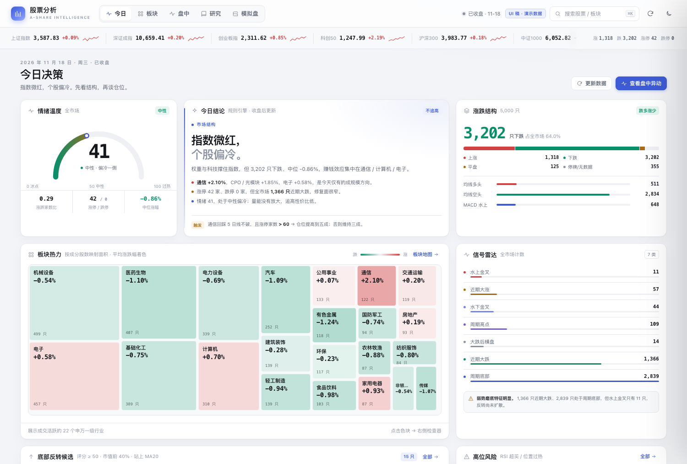
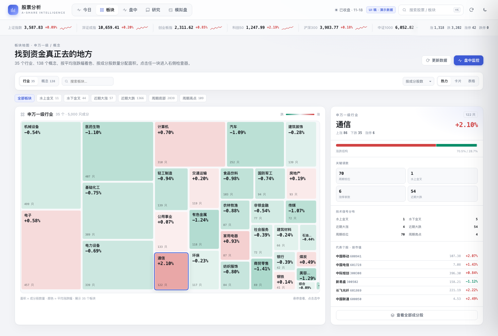
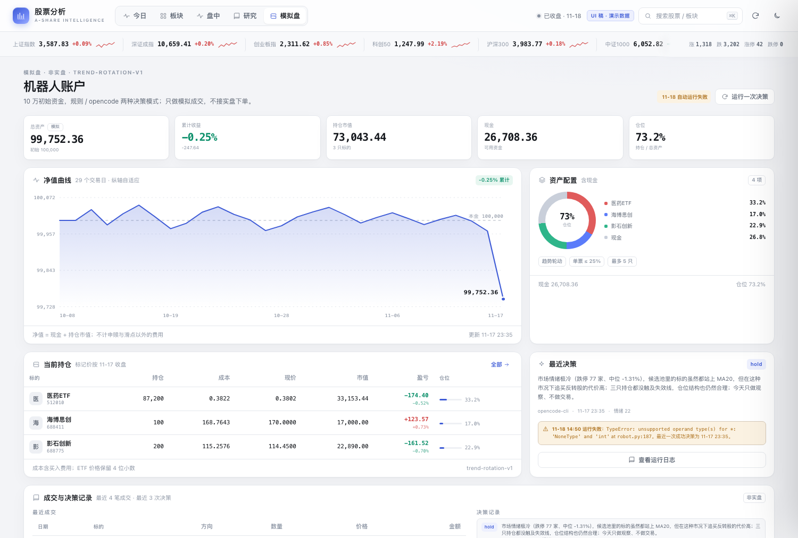

# 股票分析 · 产品交付文档

**版本** v3.0 · **日期** 2026-11-18 · **状态** 待评审  
**插件显示名** 股票分析  
**包名 / 面板 id** `@local/sector-board` / `sector-board`（保持不变）  
**配套 UI 稿** [`docs/ui-v2.html`](ui-v2.html)（可交互、演示数据）  
**旧版文档** [`docs/PRD-v1.2-archive.md`](PRD-v1.2-archive.md)

---

## 0. 交付摘要

把现有「A股板块看板」v1.8 的九分区，重构成一个 **5 工作区 + 全局搜索 + 个股技术抽屉** 的行情驾驶舱：

| 工作区 | 一句话 |
|---|---|
| 今日 | 先看结论、情绪和结构，再决定要不要动手 |
| 板块 | 行业/概念热力、卡片、表格三种看法，右侧检查器 |
| 盘中 | 异动直播、人气榜、龙虎榜、游资，解决「盘中看什么」 |
| 研究 | 主题周期、红利、全球、事件基准率，解决「为什么」 |
| 模拟盘 | 净值、持仓、配置、决策与成交，验证规则而不是下单 |

设计原则：**冷静的行情驾驶舱**，不是 Bloomberg 式满屏密度。默认浅色，可切深色；红涨绿跌只用于价格，品牌色用靛蓝；一屏先给结论，明细按需展开。

### 0.1 交付物

| 文件 | 说明 |
|---|---|
| `docs/PRD.md` | 本文档：范围、信息架构、页面规格、设计系统、验收 |
| `docs/ui-v2.html` | 高保真可交互 UI 稿，单文件，无外部依赖 |
| `docs/assets/mock-data.js` | UI 稿演示数据，基于 2026-11-18 收盘快照与真实行情补全 |
| `docs/assets/ui-preview-*.png` | 今日/板块/盘中/研究/模拟盘/抽屉/暗色预览图 |
| `docs/PRD-v1.2-archive.md` | 旧版 PRD，保留追溯 |

UI 稿可直接用浏览器打开 `docs/ui-v2.html`。所有数字标注为 **演示数据**，不连接真实接口、不写入账户。

### 0.2 预览

**今日**：一屏给结论、情绪、结构和候选。



**板块**：热力/卡片/表格三种看法，右侧检查器。



**模拟盘**：净值、配置、持仓、决策与真实错误态。



完整可交互版本见 [`docs/ui-v2.html`](ui-v2.html)；深色主题、抽屉与搜索预览见 `docs/assets/ui-preview-dark.png`、`ui-preview-drawer.png`。

### 0.3 本阶段不包含

- 不改 package name、panel id、Host 路由、数据目录。
- 不接券商、不做实盘下单。
- 不新增付费数据源；现有统计口径与刷新频率不变。
- 不做移动端原生 App；响应式最低覆盖到 860px。
- UI 稿不作为生产代码直接上线，需按第 9 节拆期迁移。

---

## 1. 背景与问题

### 1.1 现状

现有插件是一个单页面板，顶部标题、搜索、刷新，下面平铺 9 个 tab：

`决策 / 盘中 / 总览 / 信息 / 周期 / 热点 / 红利 / 全球 / 机器人`

数据侧已经比较完整：全 A 股约 5,000 只、35 个申万行业组、138 个概念板块、11 个主题、120 只红利样本、龙虎榜约 95 行、模拟盘 10 万初始资金。技术分析抽屉支持日/周/月线与 MA、BOLL、成交量、MACD、RSI、KDJ、ATR。

问题不在数据量，而在 **信息架构和视觉层级**。

### 1.2 核心问题

1. **九个平级 tab，没有任务分层。** 「决策」和「全球」一样重，「热点」和「模拟盘」混在一排，新用户不知道从哪开始。
2. **第一屏没有结论。** 打开面板先看到指数、涨跌家数和一堆 pill，需要自己拼出「今天该不该动手」。
3. **表格密度高、字号小。** 大量 10.5–11.5px 表格，层级靠字重硬撑，长时间看很累。
4. **功能入口深且分散。** 个股技术分析、板块成分、主题成分、龙虎榜席位分散在不同 tab，交互不一致。
5. **视觉语言不统一。** 有的卡片是边框，有的是底色；有的用 pill，有的用纯文字；暗色适配没有系统化。
6. **文档落后。** 旧 PRD 停在 v1.2（八分区），实际已经 v1.8（九分区），交接成本高。

### 1.3 目标

| 目标 | 可验收的描述 |
|---|---|
| 3 秒读懂 | 今日页第一屏回答：情绪多少、结论是什么、涨跌结构如何、哪些板块强 |
| 2 次点击到达 | 26 项现有功能全部能在 2 次点击内到达 |
| 一个抽屉看个股 | 所有股票入口统一打开右侧技术抽屉，不再跳不同弹窗 |
| 一致的视觉语言 | 颜色、字号、间距、卡片、表格全部来自一套 token |
| 明暗双主题 | 浅色/深色信息层级一致，无「暗色下看不清」的模块 |
| 不牺牲专业信息 | 涨跌家数、涨停跌停、均线/MACD 状态、龙虎榜席位等一个不少 |

### 1.4 非目标

- 不做交易 terminal 的全键盘操作。
- 不做社交、评论、组合分享。
- 不在本期引入外部图表库或组件库。
- 不为了「好看」删除高密度数据；密度用折叠、抽屉、切换解决。

---

## 2. 用户与任务

| 用户 | 典型时段 | 核心任务 | 对应工作区 |
|---|---|---|---|
| 盘后复盘者（主） | 16:00–23:00 | 今天发生了什么？明天做什么？ | 今日 + 板块 + 研究 |
| 盘中盯盘者 | 09:15–15:05 | 哪些票异动？人气在哪？谁在买？ | 盘中 |
| 主题/红利研究者 | 周末、盘后 | 哪些主题在周期底部？股息率够不够？ | 研究 |
| 模拟盘验证者 | 每日 14:50 后 | 规则跑得怎么样？为什么买/不买？ | 模拟盘 |
| 插件维护者 | 随时 | 数据是否新鲜？哪一步失败了？ | 全局状态 + 刷新 |

主路径：**打开面板 → 今日页读结论 → 点强势板块 → 看成分/个股抽屉 → 决定是否加入观察**。  
次路径：**盘中页看异动 → 点进个股 → 看技术位 → 回到监控池**。

---

## 3. 信息架构

### 3.1 全局框架

```
┌ Topbar ─────────────────────────────────────────────────────────┐
│ 品牌  今日 板块 盘中 研究 模拟盘        已收盘  UI稿  搜索 刷新 主题 │
├ Ribbon ─────────────────────────────────────────────────────────┤
│ 上证 深成 创业板 科创50 沪深300 …                 涨/跌/涨停/跌停 │
├ Main ───────────────────────────────────────────────────────────┤
│ 页面标题 + 说明 + 页面级动作                                      │
│ 12 栅格卡片                                                       │
├ Footer ─────────────────────────────────────────────────────────┤
│ 数据快照时间 / 生成耗时 / 来源 / 免责声明                          │
└─────────────────────────────────────────────────────────────────┘
        ↑ 全局搜索（⌘K）              ↑ 右侧技术抽屉（所有个股入口）
```

- **Topbar**：品牌、5 个工作区、市场状态、演示徽章、搜索、刷新、明暗切换。
- **Ribbon**：7 个核心指数；视口不足时按断点隐藏尾部指数，不横向溢出。
- **Main**：页面标题区 + 内容；所有页面共用 12 栅格、卡片、表格、pill。
- **全局层**：⌘K 搜索弹窗、技术抽屉、toast、刷新进度。
- **无路由**：保持单页状态切换，不引入 URL 路由；刷新页面回到「今日」。

### 3.2 五个工作区

| 工作区 | 解决的问题 | 关键模块 | 默认状态 |
|---|---|---|---|
| 今日 | 今天该不该动手 | 情绪温度、今日结论、涨跌结构、板块热力、信号雷达、底部反转候选、高位风险 | 收盘后显示「已收盘」 |
| 板块 | 钱在哪些行业/概念 | 行业/概念切换、热力/卡片/表格、筛选、排序、板块检查器 | 选中涨幅最高的行业 |
| 盘中 | 盘中发生了什么 | 异动直播、人气榜、龙虎榜、游资、监控池 | 交易时段自动轮询；非交易时段显示最近快照 |
| 研究 | 为什么是这些方向 | 主题周期、红利、全球、事件基准率 | 主题周期 |
| 模拟盘 | 规则跑得怎样 | 净值、收益、仓位、配置、持仓、决策、成交 | 机器人账户 |

### 3.3 旧九分区 → 新五工作区映射

| 旧 tab | 旧内容 | 新位置 | 说明 |
|---|---|---|---|
| 决策 | 情绪、结论、候选、风险 | 今日 | 保留全部判断逻辑，改成卡片叙事 |
| 总览 | 指数、涨跌、信号、行业/概念热力、成分 | 今日 + 板块 | 市场级放今日；板块级放板块 |
| 盘中 | 异动、监控池 | 盘中 → 异动直播 | 15 秒轮询、2 分钟去重保留 |
| 热点 | 讨论热度、龙虎榜、游资 | 盘中 → 人气榜/龙虎榜/游资 | 三个子页签 |
| 信息 | 事件日历、历史基准率 | 研究 → 事件 | 6 类事件、T-1/当日/T+1/T+5 |
| 周期 | 11 个主题周期 | 研究 → 主题周期 | 主题卡片 + 成分股 |
| 红利 | 高股息筛选 | 研究 → 红利 | ≥3%、非 ST、≥50 亿 |
| 全球 | 外股、商品、外汇 | 研究 → 全球 | 10 秒刷新 |
| 机器人 | 模拟盘 | 模拟盘 | 10 万账户、规则/opencode |
| （全局） | 技术分析抽屉、搜索 | 全局 | 统一入口；搜索支持股票/ETF/行业/概念/主题 |

**26 项现有功能逐项对照见附录 A。**

---

## 4. 页面规格

### 4.1 全局框架

**Topbar**

- 品牌：图标 +「股票分析」+ 英文小字 `A-SHARE INTELLIGENCE`。
- 导航：5 个按钮，带图标；当前项用浅靛蓝底 + 深靛蓝字。
- 右侧：`已收盘 · 11-18`、`UI 稿 · 演示数据`、搜索框、刷新、明暗切换。
- 860px 以下：隐藏市场状态和演示徽章；搜索收成图标；导航仍保留文字到 740px。

**Ribbon**

- 7 个指数：上证、深成、创业板、科创50、沪深300、中证1000、恒生科技。
- 每个：名称、点位、涨跌幅、36×14 迷你 sparkline。
- 右侧市场统计：涨/跌/涨停/跌停；1500px 以上固定悬浮，1280px 以下隐藏。
- 断点隐藏策略：≤1280 显示 5 个，≤1120 显示 4 个，≤860 显示 4 个（更紧凑）。

**Footer**

- 数据快照时间、生成耗时、数据来源。
- 免责声明：演示数据、不构成投资建议。
- 说明「与现有 sector-board 插件功能一一对应」。

### 4.2 今日

**目的**：收盘后 3 秒回答「今天市场怎么样、明天该怎么做」。

| 模块 | 内容 | 数据来源 | 交互 |
|---|---|---|---|
| 情绪温度 | 0–100 半圆仪表，41 / 中性；副指标：涨跌家数比、涨停/跌停、中位涨幅；底部提示「中性偏冷」 | `decision.sentiment` | 无；数字可 hover 解释 |
| 今日结论 | 一句主结论「指数微红，个股偏冷。」；3 条结构要点；触发条件；规则引擎/更新时间 | `decision` | 点「盘中异动」跳盘中 |
| 涨跌结构 | 3,202 只下跌、占 64.0%；上涨/平盘/停牌/无数据；均线多头/空头、MACD 水上/水下条 | `market` | 点数字筛选板块？本期不做，仅展示 |
| 板块热力 | 面积=成分数、颜色=平均涨跌；展示成交活跃的 22 个申万一级行业 | `sectors` | 点色块 → 板块页并选中；点「板块地图」→ 板块页 |
| 信号雷达 | 7 类信号：水上金叉、近期大涨、水下金叉、周期高点、大跌后横盘、近期大跌、周期底部；右侧计数 + 横条 | `signals` | 点信号 → 板块页按信号筛选 |
| 底部反转候选 | 15 只；列：评分、现价、涨跌、1 年位置、触发证据；评分 ≥50、市值前 40%、站上 MA20 等 | `decision.leaders` | 点行打开技术抽屉；「全部」进入候选列表 |
| 高位风险 | RSI 超买/位置过热；股票、行业、RSI、当日涨幅 | `decision.risks` | 点行打开技术抽屉 |

**首屏排序**：情绪（左，3 列）→ 结论（中，5 列）→ 涨跌结构（右，4 列）；第二行板块热力（8 列）+ 信号雷达（4 列）；第三行候选（8 列）+ 风险（4 列）。

**状态**

- 收盘后：标题区显示「2026 年 11 月 18 日 · 周三 · 已收盘」。
- 盘中：显示「盘中 · 数据每 15 秒刷新」，情绪卡加「实时」小标。
- 无数据：整页空状态，主按钮「更新数据」，说明首次抓取约 4–6 分钟。
- 数据过期：标题区加「快照 11-18 20:56」黄色 pill，hover 说明不是实时。

### 4.3 板块

**目的**：从全市场热力快速定位行业/概念，再看成分与技术状态。

**工具栏**

- 类型切换：申万行业（35 组，含「-」未分类）/ 概念板块（138 个）。
- 视图切换：热力 / 卡片 / 表格。
- 筛选 chips：全部、上涨、下跌、水上金叉、水下金叉、近期大涨、大跌后横盘、周期底部、周期高点。
- 排序：股票数、平均涨幅、信号数、名称。
- 板块内搜索：按名称过滤。
- 计数：「35 个行业 / 138 个概念」。

**三种视图**

| 视图 | 规格 | 适用 |
|---|---|---|
| 热力 | squarified treemap；面积=成分数、颜色=平均涨跌；块内显示名称、均涨、成分数；选中加 2px 靛蓝描边 | 快速扫强弱 |
| 卡片 | 3 列卡片；名称、均涨、涨跌家数、前三信号、代表股 | 逐个比较 |
| 表格 | 列：板块、成分、均涨、上涨/下跌、涨停、信号、1 年位置中位、PE 中位；可排序 | 精确排序 |

**右侧检查器**

- 头部：板块名、类型、成分数、均涨 pill。
- 涨跌结构：上涨/下跌/平盘/涨停/跌停。
- 关键读数：1 年位置中位、5 年位置中位、PE 中位、PB 中位、5 日中位。
- 技术信号：signal pills + 计数。
- 代表个股：市值前 8，名称/代码/现价/涨跌/PE/市值。
- 底部：「查看全部成分」打开完整列表（生产版复用现有成分面板）。
- 空状态：「该板块今天没有命中这个信号。」

**交互**

- 点热力块/卡片/表格行 → 选中，右侧检查器联动；不跳页。
- 点代表个股 → 技术抽屉。
- 切换行业/概念 → 保留筛选和视图，重置选中到第一个。
- 搜索无结果 → 空状态 + 清除搜索。

### 4.4 盘中

**目的**：交易时段内，一屏看到「谁在异动、谁有人气、谁在上榜、谁在买」。

**子页签**

1. **异动直播**（默认）
   - 交易时段 09:15–11:35、12:55–15:05，每 15 秒轮询监控池（≤500 只）。
   - 规则：跌停撬板、涨停打开、急拉（3 分钟 ≥2%）、急跌（3 分钟 ≤-2%）；同股同规则 2 分钟去重。
   - 左侧时间轴：时间、类型、股票、触发价、幅度、成交额；新事件置顶并高亮 2 秒。
   - 右侧监控池：涨跌幅、涨速、量比、成交额、换手；可排序；点行打开抽屉。
   - 非交易时段：显示「已收盘，以下为最近快照」，不再轮询。
2. **人气榜**
   - 同花顺人气榜前 30；列：排名、股票、涨跌幅、热度、榜单标签、技术状态。
   - 3 分钟刷新；前 8 只补 MA/MACD/RSI/1 年位置。
   - 失败降级：东财股吧人气；页面显示「数据源降级」小标。
3. **龙虎榜**
   - 上榜股 + 净买/净卖、成交额、上榜原因；点行展开席位：机构/营业部、买入、卖出、净额。
   - 默认展开净买额最高的一只（演示数据为 688183 生益电子）。
4. **游资**
   - 剔除「机构专用」后的净买个股；活跃营业部榜；点营业部看关联股票。
   - 异常值标注：净买额显著高于样本（如 26.78 亿）时加「异常值」提示，不直接当信号。

**顶部 mini KPI**：异动数、涨停、跌停、监控池、人气榜更新时间。

### 4.5 研究

**目的**：把「主题、红利、全球、事件」放在同一个研究工作台，减少跨 tab 跳转。

#### 4.5.1 主题周期

- 11 个主题，按科技周期/消费周期/新能源周期/地产链/资源周期分组。
- 左侧主题卡片：名称、阶段 pill（底部/震荡/上行/下行）、成分数、当日均涨。
- 右侧详情：阶段、1 年位置中位、5 年位置中位、PE 中位、PB 中位、5 日中位、成交额中位。
- 成分股：市值前 6；列：名称/代码、现价、涨跌、PE、1 年位置、技术状态；点行开抽屉。
- 底部：「搜索主题成分股」沿用现有主题弹窗。
- 主题无成分（如恒生科技）→ 显示「暂无 A 股成分」，不伪造数据。

#### 4.5.2 红利

- 口径：近 12 个月股息率 ≥3%、非 ST、总市值 ≥50 亿；按股息率降序，最多 120 只。
- 统计：样本数、中位股息率、中位 PE、中位 PB、上涨/下跌、筛选结果。
- 筛选：全部、股息率 >6%、连续分红 ≥3 年、非周期行业。
- 表格列：股票、行业、股息率、DPS、现价、PE、PB、1 年位置、连续分红、5 日。
- 点行开抽屉；搜索支持股票/行业。

#### 4.5.3 全球

- 5 组：A股/港股/美股指数、国家 ETF/ADR、商品（金/银/油）、外汇、美元指数。
- 每行：名称、最新值、涨跌幅；上涨红、下跌绿。
- 10 秒刷新；页脚注明「用于观察外部风险偏好，不做跨市场套利建议」。
- 数据失败：保留上一次快照，右上角显示「延迟」。

#### 4.5.4 事件

- 6 类事件：股指期货交割日、LPR、FOMC、两会、政治局会议、中央经济工作会议。
- 每类：规则、样本 n、T-1/当日/T+1/T+5 的胜率与均值；`n<5` 标「估算/仅供参考」。
- 未来 30 天时间轴：日期、事件、类型。
- 「怎么读」说明：基准率不是预测，样本越小越要谨慎。
- 数据 6 小时缓存；页脚注明来源与计算窗口。

### 4.6 模拟盘

**目的**：验证规则，不接实盘。

**账户**

- 初始 100,000 元；ETF 按 100 份取整，A 股 100 股取整；双边费率 0.05% + 滑点 0.05%。
- 约束：最多 3 只、单只 ≤34%、浮亏 -8% 强制卖出；工作日 14:50 自动运行。
- 两种决策模式：规则、opencode；模式与模型在页面可见。

**模块**

| 模块 | 内容 |
|---|---|
| KPI | 总资产、累计收益、持仓市值、现金、仓位；标注「模拟」 |
| 净值曲线 | 29 个交易日；本金 100,000 虚线；标题注明「纵轴自适应」，避免把 -0.25% 看成暴跌 |
| 资产配置 | donut：各持仓 + 现金；右侧图例显示金额与占比；下方显示仓位 |
| 当前持仓 | 标的、持仓、成本、现价、市值、盈亏、仓位条；点行开抽屉 |
| 最近决策 | 决策（hold/buy/sell）、理由、模型、时间、情绪分；失败时显示真实错误 |
| 成交与决策记录 | 最近 4 笔成交 + 最近 3 次决策；「非实盘」标记 |

**已知真实问题（必须保留在文档里）**

`robot.py:187` 在 2026-11-18 14:50 运行失败：

```
TypeError: unsupported operand type(s) for *: 'NoneType' and 'int'
```

原因是 `x.get('pct', 0) * 100` 取到了 `None`。UI 不伪造「运行正常」，而是在决策卡里显示黄色告警和「查看运行日志」。生产修复前，模拟盘页必须保留这个状态。

**刷新**：净值每 10 秒刷新；决策在收盘后用日线跑；不接实时下单。

### 4.7 个股技术抽屉

**入口**：所有带 `data-stock` 的行/卡片/热力块；搜索选中；候选/风险/持仓/龙虎榜/游资/红利/主题成分。

**头部**

- 名称、代码、行业；演示数据加「演示」标。
- 现价、涨跌幅；MA20 金叉/技术状态 pill。
- 四格指标：PE/PB、总市值、换手率、1 年位置。

**价格结构**

- 日/周/月切换。
- K 线 + MA5/10/20/60 + 成交量 + MACD。
- 生产版保留现有 BOLL、RSI、KDJ、ATR；UI 稿先以 K/量/MACD 控制高度。
- 轴标签、日期、前复权标识；数据不足时显示「样本不足」。

**技术解读**

- 一句话结论；均线状态、MACD 位置、RSI、评分、量比、股息率等 pill。
- 证据列表：1 年位置、站上 MA20、MA20 斜率、量比、金叉。
- 触发条件 / 失效条件两张小卡。
- 底部动作：加入自选、查看完整行情（生产版接现有行为）。

**交互**

- 打开时锁定背景滚动，点遮罩/×/ESC 关闭。
- 周/月切换不重新请求，前端聚合日线。
- 非真实序列明确标注「演示序列」，不冒充行情。

### 4.8 全局搜索（⌘K）

- 快捷键：⌘K / Ctrl+K 打开，ESC 关闭。
- 搜索范围：股票、ETF、行业、概念、主题。
- 结果分组顺序：股票 → ETF → 行业 → 概念 → 主题；组内按匹配度。
- 股票/ETF：打开技术抽屉；行业/概念：跳板块页并选中；主题：跳研究页并选中。
- 键盘：↑/↓ 选择，Enter 打开，ESC 关闭；结果自动滚动到可视区。
- 无结果：显示示例关键词，不显示空白。
- 索引懒构建，覆盖决策候选/风险、热点、红利、龙虎榜、游资、模拟盘持仓、板块/概念代表股、主题成分股。

### 4.9 数据刷新

- 顶栏「更新数据」= `POST /api/sector-board/refresh`。
- 运行中：按钮禁用 + 旋转图标 + 「更新中…」；页面每 5 秒轮询 `status.json`。
- 完成：toast「数据已更新」，自动重载 dashboard。
- 失败：toast 错误 + 保留旧快照；页脚显示上次成功时间。
- 首次无数据：整页空状态，说明抓取约 4–6 分钟，可离开页面。
- 收盘后不自动刷新实时行情；盘中 15 秒、全球/模拟盘 10 秒、人气榜 3 分钟。

---

## 5. 设计系统

### 5.1 原则

1. **结论先于数据。** 先给一句人话，再给支撑数字。
2. **颜色只表达方向。** 红涨绿跌只用于价格/涨跌；品牌色、强调色不参与涨跌语义。
3. **密度分层。** 首屏 11.5–13px；表格 11.5px；元信息 9.5–10px；不靠 9px 撑全屏。
4. **一个抽屉。** 所有个股都走同一个技术抽屉，减少认知切换。
5. **可扫读。** 数字用 tabular-nums；标签左对齐；计数右对齐；卡片有 eyebrow。
6. **不引依赖。** 纯 HTML/CSS/JS + 手写 SVG，避免插件体积和 CSP 风险。

### 5.2 颜色 token

| Token | 浅色 | 深色 | 用途 |
|---|---|---|---|
| `--bg` | `#F3F4F7` | `#090B0F` | 页面底色 |
| `--surface` | `#FFFFFF` | `#11141A` | 卡片 |
| `--surface-2` | `#F8F9FB` | `#171B22` | 次级底、hover |
| `--surface-3` | `#EEF0F4` | `#1E232C` | 轨道、分隔 |
| `--border` | `#E4E7EC` | `#232834` | 1px 边框 |
| `--border-2` | `#D5DAE3` | `#2E3542` | hover 边框 |
| `--text` | `#14171C` | `#EDF0F5` | 主文字 |
| `--text-2` | `#5B6472` | `#A7B0BF` | 次文字 |
| `--text-3` | `#8A93A2` | `#6F7A8C` | 元信息 |
| `--accent` | `#3E5BD6` | `#7C93FF` | 品牌/选中/主按钮 |
| `--accent-soft` | `#EEF1FE` | `#1B2340` | 选中底 |
| `--up` | `#D14343` | `#FF6B6B` | 上涨/涨停 |
| `--down` | `#0B8F6A` | `#38D6A4` | 下跌/跌停 |
| `--warn` | `#A96A12` | `#E0A94A` | 风险/延迟 |
| `--violet` | `#7A5AD6` | `#A88BFF` | 周期/主题辅助 |

使用规则：

- 涨跌数字、涨跌幅 pill、热力块用 `--up/--down`；其他场景禁止红绿。
- 主按钮/选中态用 `--accent`；不用品牌色表示涨跌。
- 热力块颜色 = 均涨映射到 5 档红绿，透明度 0.18–0.55；文字始终用 `--text`。
- 深色下热力块降低饱和度，避免大面积荧光。

### 5.3 字体与数字

```
正文：-apple-system, BlinkMacSystemFont, "SF Pro Text", "PingFang SC", "Microsoft YaHei", sans-serif
等宽："SF Mono", ui-monospace, "JetBrains Mono", Menlo, monospace
```

| 层级 | 字号 | 字重 | 用途 |
|---|---|---|---|
| 页面标题 | 24px | 650 | 今日决策/板块/模拟盘 |
| 卡片标题 | 11.5px | 650 | 卡片头 |
| 主数字 | 22–30px | 680 | 情绪 41、下跌 3,202 |
| 表格正文 | 11.5px | 450–600 | 股票/板块表 |
| 元信息 | 9.5–10px | 500 | 代码、时间、注脚 |
| 等宽数字 | 10–13px | 600 | 指数、价格、涨跌 |

- 所有数字 `font-variant-numeric: tabular-nums`。
- 不用全大写中文；英文 eyebrow 可用 `letter-spacing:.08em`。
- 行高：标题 1.15；正文 1.55；表格 1.3。

### 5.4 间距、圆角、阴影

- 间距基数 4px；常用 6/8/10/12/16/20/24。
- 卡片圆角 10px；按钮 7–8px；pill 999px；抽屉 0（贴右）。
- 卡片：`1px solid var(--border)` + `0 1px 2px rgba(16,24,40,.03)`；hover 只改边框，不做大位移。
- 抽屉阴影：`-24px 0 60px rgba(16,24,40,.18)`；遮罩 `rgba(12,16,24,.32)` + 2px 模糊。
- 禁止大面积渐变；仅 ribbon 右侧渐隐、情绪仪表弧使用渐变。

### 5.5 组件

| 组件 | 规格 |
|---|---|
| Card | 头部 38px，标题 11.5px，右上角 pill/动作；body padding 12–14px |
| Pill | 高 19–21px，圆角 999，字号 9–10；变体：up/down/warn/accent/outline |
| Chip | 高 24px，圆角 6；选中浅靛蓝底 + 靛蓝字 |
| Segmented | 高 24–26px，底色 surface-2，选中白底 + 阴影 |
| Table | 表头 9.5px 大写色 text-3；行高 34px；hover surface-2；数字右对齐 |
| Avatar | 22–26px 方块圆角 6，浅色底，首字 |
| Score ring | 26px SVG 圆环；≥60 靛蓝，40–59 灰，<40 黄 |
| Posbar | 42×3 轨道 + 填充 + 右侧百分比；<5% 也保留 2px 最小可见 |
| Treemap | squarified；1px 间隙；块内名称 11px/700，均涨 10px；面积<2% 隐藏成分数 |
| Gauge | 半圆 180°；0/50/100 刻度；指针 + 中心大数字；弧色按分数分段 |
| Drawer | 510px；头部 72px；价格 56px；图表 250px；底部动作固定 |
| Modal | 620px；搜索框 44px；结果行 40px；分组标题 9px |

### 5.6 图表规范

- 全部手写 SVG，viewBox 自适应；线宽 1–1.5px。
- K 线：阳线 `--up`、阴线 `--down`；影线 1px；MA5 金、MA10 蓝、MA20 紫、MA60 灰。
- 成交量：与 K 线同色，透明度 0.55；不画均量线（避免过密）。
- MACD：DIF 蓝、DEA 橙、柱红绿；零轴 1px 虚线。
- 净值曲线：靛蓝 1.6px + 8% 面积渐变；本金虚线；末端点 3px；纵轴自适应时必须在标题注明。
- 热力：颜色只映射均涨，不映射市值；面积映射成分数；图例放右上。
- 空数据：画基线 + 「样本不足」，不画假曲线。

### 5.7 可访问性

- 正文对比度 ≥4.5:1；9.5px 元信息 ≥4.5:1（深色 `#6F7A8C` 仅用于非关键注脚）。
- 涨跌不只靠颜色：数字带 +/−，pill 带文字，表格有方向词。
- 键盘：Tab 可达导航/搜索/表格行；抽屉/搜索支持 ESC；焦点环 2px accent。
- 动效：页面切换 280ms、抽屉 260ms；`prefers-reduced-motion` 下关闭。
- 触控目标 ≥32px；表格行 34px。

### 5.8 响应式

| 断点 | 行为 |
|---|---|
| ≥1440 | 三列首屏；ribbon 7 指数 + 统计 |
| 1280–1439 | 三列保持；隐藏 ribbon 统计；显示 5 指数 |
| 1120–1279 | 今日页列宽收窄；显示 4 指数；卡片内文字允许换行 |
| 860–1119 | 今日页单列；板块检查器移到下方；显示 4 指数；搜索图标化 |
| <860 | 导航图标+文字到 740，再隐藏文字；表格横向滚动；抽屉全宽 |

验收以 1500 / 1280 / 860 三个宽度为准。

---

## 6. 交互与状态

### 6.1 关键交互

| 交互 | 行为 |
|---|---|
| 顶部导航 | 切换工作区；保留各页筛选状态；滚动回顶部 |
| 今日「查看盘中异动」 | 跳盘中，默认异动直播 |
| 热力块/板块行 | 选中并更新右侧检查器，不跳页 |
| 今日信号 pill | 跳板块页并设置对应筛选 |
| 表格排序 | 点表头切换 asc/desc；箭头指示；不重置筛选 |
| 搜索 | ⌘K 打开；输入 120ms 防抖；↑↓/Enter/ESC |
| 个股入口 | 统一打开抽屉；不叠加多个弹窗 |
| 刷新 | 禁用按钮；5 秒轮询；完成 toast + 重载 |
| 主题切换 | 立即切换 `data-theme`；记住 localStorage；首屏无闪烁 |
| 演示徽章 | 始终可见；hover 说明「非实时、不构成建议」 |

### 6.2 状态矩阵

| 状态 | 页面表现 |
|---|---|
| Loading | 骨架屏：标题条 + 3 张卡片轮廓；不显示 0 |
| Empty | 插画/图标 + 一句解释 + 主按钮（更新数据/清除筛选） |
| Error | 卡片级错误条「加载失败，保留上次数据」+ 重试 |
| Stale | 标题区黄色 pill「快照 11-18 20:56」；tooltip 说明 |
| No result | 搜索/筛选无结果，给示例关键词或清除按钮 |
| Partial | 某个模块失败只影响该卡片；其余正常 |
| Market closed | 盘中页显示「已收盘」，停止轮询，保留最近快照 |
| Robot failed | 模拟盘决策卡黄色告警 + 日志入口；不显示「正常」 |

### 6.3 文案基调

- 短句、动词开头、说人话：
  - 「指数微红，个股偏冷。」
  - 「权重与科技撑住指数，但 3,202 只下跌、中位 -0.86%。」
  - 「情绪 41，处于中性偏冷；量能没有放大，追高性价比低。」
  - 「按计划执行，不追高。」
- 风险提示不吓人，但明确：「仅研究，不构成建议」「样本 n<5，仅供参考」。
- 不写「AI 预测」「必涨」「稳赚」。

---

## 7. 数据与接口

### 7.1 现有接口（不改）

| 接口 | 用途 | 刷新 |
|---|---|---|
| `GET /api/sector-board/dashboard.json` | 市场、板块、主题、决策、龙虎榜、游资、红利 | 手动/ETL |
| `GET /api/sector-board/etf.json` | ETF 列表与指标 | 手动/ETL |
| `GET /api/sector-board/search.json` | 股票/ETF 搜索索引 | 手动/ETL |
| `GET /api/sector-board/global.json` | 外股/商品/外汇 | 10s |
| `GET /api/sector-board/quotes.json?codes=` | 批量实时报价 | 按需 |
| `GET /api/sector-board/paper.json` | 模拟盘账户 + 实时标记 | 10s |
| `GET /api/sector-board/status.json` | ETL 状态 | 5s（刷新中） |
| `GET /api/sector-board/live.json?codes=` | 盘中监控池报价 | 15s |
| `GET /api/sector-board/events.json` | 事件日历 + 基准率 | 6h 缓存 |
| `GET /api/sector-board/hot.json` | 人气榜 | 3min 缓存 |
| `GET /api/sector-board/stock.json?code=&period=` | 个股日线 + 指标 | 60s 缓存 |
| `POST /api/sector-board/refresh` | 启动 ETL | 手动 |
| `POST /api/sector-board/paper/decide` | 跑一次模拟盘决策 | 手动 |
| `POST /api/sector-board/paper/init` | 初始化账户 | 手动 |
| `POST /api/sector-board/robot/run` | 机器人决策 | 手动/launchd |

### 7.2 页面与字段

| 页面 | 主要字段 |
|---|---|
| 今日 | `market`、`signals`、`decision.sentiment`、`decision.leaders/risks`、`sectors` |
| 板块 | `sectors[]`、`boards.concept[]`（统计字段）、`search.json` + `board_cache.json` 重建成分 |
| 盘中 | `live.json`、`hot.json`、`lhb`、`youzi` |
| 研究 | `themes`、`theme_groups`、`dividend`、`global`、`events` |
| 模拟盘 | `paper`（positions/trades/equity/decisions/robot） |
| 抽屉 | `stock.json`；演示稿用 `D.stock` 与确定性序列 |

> 注意：`dashboard.json` 的 `sectors[]` / `concepts[]` 只有统计字段，没有成分股列表。生产版展示代表股/全部成分必须用 `search.json` + `board_cache.json` 重建，或由 ETL 增加 `peers` 字段。UI 稿的 `sectors[].peers` / `concepts[].peers` 是为演示补的。

### 7.3 性能预算

| 项 | 目标 |
|---|---|
| 首屏可交互 | <1.5s（缓存命中，dashboard 已加载） |
| 页面切换 | <100ms（纯前端重渲染） |
| 搜索输入到结果 | <80ms（6,000 条索引，120ms 防抖） |
| Treemap 重排 | <50ms（≤40 个块） |
| 表格 | >200 行时虚拟滚动或分页；首屏 ≤120 行 |
| 内存 | 不重复保存完整日线；抽屉关闭释放图表 DOM |

---

## 8. 非功能要求

- **浏览器**：Chrome / Edge / Safari 最近两个大版本；DSH Web 面板内嵌。
- **分辨率**：1280×800 起；860px 可用；不承诺手机竖屏。
- **主题**：浅色/深色都必须通过对比度检查；跟随系统仅作为初始值，用户选择优先。
- **依赖**：零外部 UI/图表库；不新增网络请求到第三方（现有行情代理除外）。
- **安全**：不改变 DSH 鉴权；不把 token 写入前端；演示数据不含个人信息。
- **可维护性**：颜色/字号/间距全部 token 化；页面模块函数化；不在模板里写魔法色值（图表序列色除外）。
- **国际化**：本期中文；英文 locale 保留标题翻译，不承诺全量。
- **降级**：行情源失败保留上次快照；人气榜失败切东财；全球失败显示延迟。

---

## 9. 迁移与实施

### 9.1 分阶段

| 阶段 | 内容 | 产出 |
|---|---|---|
| P0 命名与 token | 插件显示名改「股票分析」；建立 CSS 变量层；明暗主题 | `package.json`、locale、`client.js` 样式入口 |
| P1 壳 + 今日 + 板块 | Topbar/ribbon/footer；今日 7 卡；板块三视图 + 检查器 | 可替换旧「决策/总览」 |
| P2 盘中 + 研究 | 4 个子页签；主题/红利/全球/事件 | 替换旧「盘中/热点/信息/周期/红利/全球」 |
| P3 模拟盘 + 抽屉 + 搜索 | 净值/持仓/决策；统一抽屉；⌘K | 替换旧「机器人」与多个弹窗 |
| P4 清理 | 删除旧 tab 样式与死代码；补测试；更新 README | v3.0 |

### 9.2 兼容策略

- package name、panel id、路由、数据目录不变；只改展示名。
- 建议保留旧视图一个版本，通过内部开关切换；确认无回归后再删。
- 旧 `docs/PRD.md` 已归档为 `docs/PRD-v1.2-archive.md`；新文档为唯一口径。
- 数据字段新增（如 `sectors[].peers`）必须向后兼容，旧字段不删。

### 9.3 测试

- 单元：treemap 布局、搜索分组、指标计算、涨跌颜色映射。
- 组件：卡片空/错/加载态；抽屉日/周/月；表格排序。
- 端到端：26 项旧功能逐项在新 IA 中找到；刷新流程；模拟盘决策失败态。
- 视觉：1500/1280/860 三档 × 明暗两主题截图对比。
- 数据：5,000 只、35 行业、138 概念、11 主题、120 红利、95 龙虎榜不丢。

### 9.4 参考调研（GitHub / DSH 插件市场）

调研时间 2026-11-18；DSH 市场目录 `awesome-dsh-plugin.com/plugins.json` 共 11,744 条，其中 `ui` 分类 2,351 条。

| 项目 | 可借鉴点 | 结论 |
|---|---|---|
| `omdsh-dev/dsh-genui` | 内联图表、布局与表单组件 | 交互模式参考；不引入其渲染层 |
| `kenz1117/dsh-ui-usage-billing` | KPI 卡片与用量 dashboard | 指标卡信息层级参考 |
| `theBigGavin/marketingdashboard` | 一屏式行情大屏、指数 ribbon | 首屏信息架构参考 |
| `SuCriss/dsh-leekbox` | A 股看盘、情绪温度计、龙虎榜 | 功能口径交叉验证 |
| `xuexiaolei1997/dsh-plugin-stock-x` | 悬浮球/抽屉、多市场行情 | 抽屉入口参考 |
| `FTShare-Lab/dsh_kline` | 交互式 K 线 | K 线信息层级参考 |

结论：生态中没有可直接复用的「A 股板块看板 + 模拟盘」整包；本稿只借信息架构与图表模式，**不引入第三方 UI/图表依赖**，保持零依赖、可被 DSH 主题 token 接管。

---

## 10. 验收标准

| # | 标准 | 判定 |
|---|---|---|
| 1 | 插件显示名为「股票分析」 | package/locale/README 三处一致 |
| 2 | 顶部只有 5 个工作区 | 无第 6 个一级入口 |
| 3 | 今日首屏含情绪、结论、涨跌结构、板块热力、信号、候选、风险 | 7 项均可见 |
| 4 | 板块支持行业/概念、热力/卡片/表格、筛选/排序、检查器 | 全部可用 |
| 5 | 盘中 4 子页签齐全；15s/2min/3min 规则不变 | 代码/交互核对 |
| 6 | 研究 4 子页签齐全；11 主题、红利口径、全球、事件基准率 | 数据核对 |
| 7 | 模拟盘 KPI/净值/配置/持仓/决策/成交齐全；错误态真实 | 含 robot.py 告警 |
| 8 | 任意个股入口打开同一抽屉；日/周/月可切 | 抽测 10 个入口 |
| 9 | ⌘K 支持股票/ETF/行业/概念/主题；键盘可用 | 抽测 5 类 |
| 10 | 明暗双主题无不可读模块 | 截图对比 |
| 11 | 1280/860 无横向溢出；无 console error | 自动化检查 |
| 12 | 26 项旧功能全部可达，无数据口径变化 | 附录 A 逐项签字 |

---

## 11. 风险与开放问题

| 风险 | 影响 | 应对 |
|---|---|---|
| `robot.py:187` NoneType | 模拟盘决策失败，页面显示错误 | 先修 `pct` 空值；UI 保留告警，不伪装成功 |
| 行情接口限流/失败 | 盘中/全球空窗 | 保留上次快照；指数退避；页面标「延迟」 |
| 5,000 只全量 DOM | 卡顿 | 表格虚拟化/分页；treemap 只渲染可见块 |
| 红绿语义对色盲不友好 | 误读涨跌 | 数字带 +/−；文字标签；避免只靠色块 |
| 快照过期被当实时 | 决策误判 | 标题区快照时间 + 演示徽章 + tooltip |
| 名称改「股票分析」但包名仍旧 | 安装/文档混淆 | README/PRD 明确写「显示名 vs 包名」 |
| UI 稿演示数据被误用 | 投资误判 | 全页「演示数据」徽章；PRD 与页脚免责声明 |
| 外部 UI 库引入 | 体积/CSP/升级风险 | 本期零依赖；后续评估需单独评审 |

**开放问题**

1. 板块检查器的「全部成分」是右侧抽屉还是独立页？UI 稿先沿用现有弹窗。
2. 今日「涨跌结构」点击数字是否要联动板块筛选？本期只展示，避免误触。
3. 模拟盘是否需要在今日页加一张「机器人在跑」摘要卡？当前放在模拟盘，避免首屏过载。
4. 全球行情是否要并入 ribbon？当前保留 7 个 A 股/港股指数，全球在研究页。
5. 事件基准率的「估算」标记阈值是否统一为 n<5？当前按 n<5 提示。

---

## 附录 A · 旧九分区功能清单（逐项）

| # | 旧 tab | 功能 | 新位置 | 状态 |
|---|---|---|---|---|
| 1 | 决策 | 情绪温度 0–100 | 今日 | 保留 |
| 2 | 决策 | 今日结论/触发条件 | 今日 | 保留 |
| 3 | 决策 | 高位风险 | 今日 | 保留 |
| 4 | 决策 | 底部反转候选（行业前 40%、≥50 亿、分位≤40%、MA20、斜率、量比、MACD） | 今日 | 保留 |
| 5 | 决策 | 候选表开技术抽屉 | 今日/全局 | 统一 |
| 6 | 盘中 | 09:15–11:35 / 12:55–15:05 每 15 秒轮询 ≤500 只 | 盘中 | 保留 |
| 7 | 盘中 | 跌停撬板/涨停打开/急拉急跌，2 分钟去重 | 盘中 | 保留 |
| 8 | 盘中 | 异动列表 + 监控表排序 | 盘中 | 保留 |
| 9 | 总览 | 指数条 | 全局 ribbon | 保留 |
| 10 | 总览 | 市场温度/涨跌家数 | 今日 | 保留 |
| 11 | 总览 | 7 类技术信号 pill | 今日/板块 | 保留 |
| 12 | 总览 | 申万行业 31/35 与概念 138 切换 | 板块 | 保留 |
| 13 | 总览 | Treemap/卡片视图、排序、板块内搜索 | 板块 | 保留 + 表格 |
| 14 | 总览 | 成分股面板（技术标签） | 板块检查器 | 保留 |
| 15 | 总览 | 全局搜索（股票/代码/ETF/板块/概念） | ⌘K | 保留 + 主题 |
| 16 | 热点 | 讨论热度前 30（3 分钟） | 盘中/人气榜 | 保留 |
| 17 | 热点 | 龙虎榜 + 席位展开 | 盘中/龙虎榜 | 保留 |
| 18 | 热点 | 游资净买 + 活跃营业部 | 盘中/游资 | 保留 |
| 19 | 信息 | 事件日历 | 研究/事件 | 保留 |
| 20 | 信息 | 历史基准率 T-1/当日/T+1/T+5 | 研究/事件 | 保留 |
| 21 | 周期 | 11 主题分组、周期分析、成分股 | 研究/主题周期 | 保留 |
| 22 | 红利 | ≥3%、非 ST、≥50 亿、最多 120 只 | 研究/红利 | 保留 |
| 23 | 全球 | 指数/ETF/ADR/金/银/油/美元/外汇，10 秒 | 研究/全球 | 保留 |
| 24 | 机器人 | 10 万模拟盘、净值、收益、持仓、成交、决策 | 模拟盘 | 保留 |
| 25 | 机器人 | 规则/opencode 两种模式，10 秒净值 | 模拟盘 | 保留 |
| 26 | 通用 | 技术抽屉：日/周/月、MA/BOLL/量/MACD/RSI/KDJ/ATR + 解读 | 全局抽屉 | 保留（UI 稿先精简） |

---

## 附录 B · 演示数据说明

- 快照：`as_of 2026-11-18`，`generated_at 2026-11-18T20:56:32+08:00`，耗时 285.3s，5,000 只。
- 指数/全球/个股价格：腾讯行情 2026-11-18 收盘。
- 情绪 41、下跌 3,202、中位 -0.86%、15 候选/15 风险：来自真实 dashboard。
- 模拟盘：`paper.json` 真实账户（总资产 99,752.36，三只持仓），净值曲线 29 个交易日演示序列。
- 主题、红利、龙虎榜、游资：真实快照；部分股票报价缺失时用腾讯行情补齐。
- 所有页面右上角「UI 稿 · 演示数据」常驻；页脚免责声明不可关闭。

---

## 附录 C · 变更记录

| 版本 | 日期 | 变更 |
|---|---|---|
| v3.0 | 2026-11-18 | 九分区 → 五工作区；新增 UI 稿、设计系统、验收标准；显示名改「股票分析」 |
| v1.2 | 旧 | 八分区 + 实时 + 模拟盘（已归档） |
