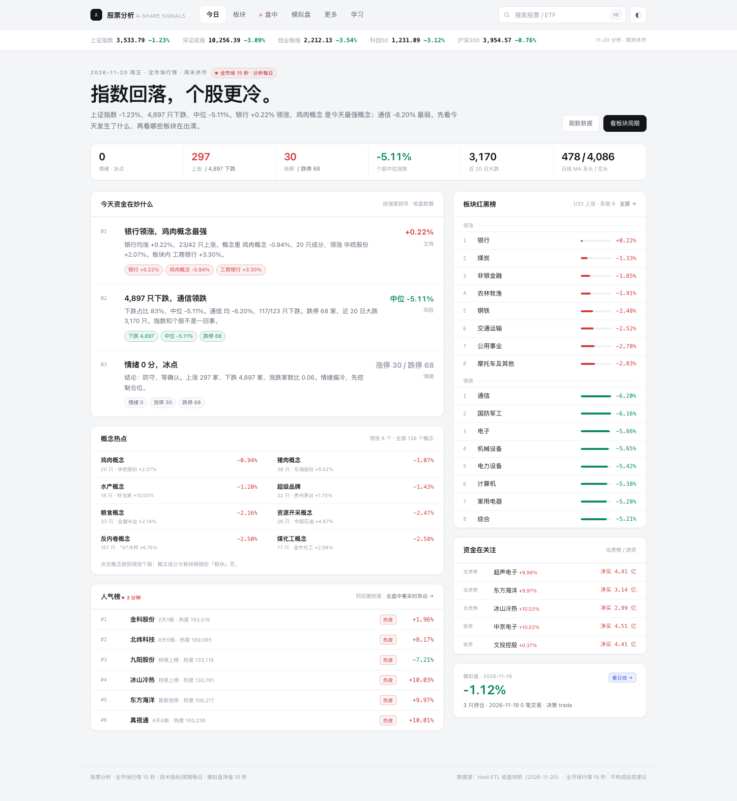
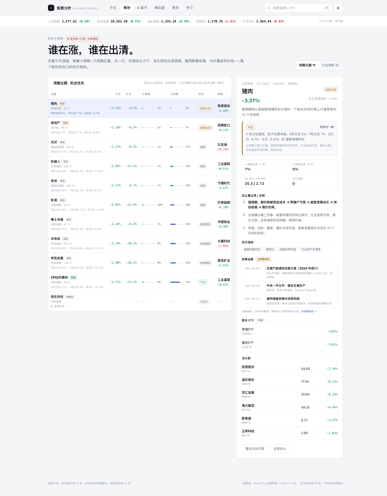
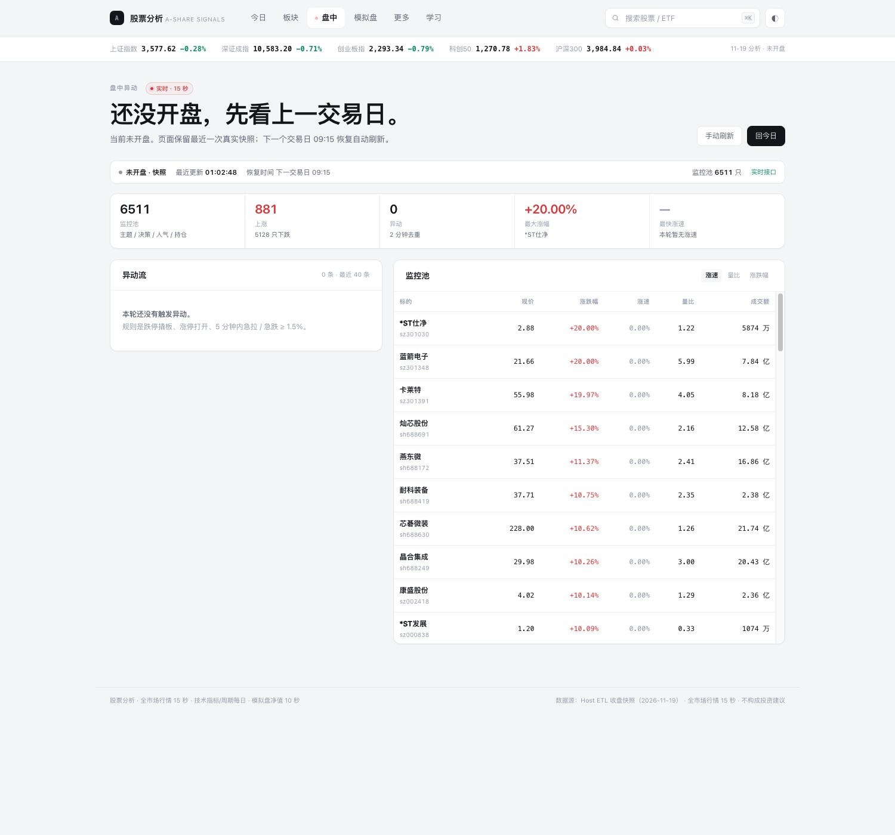
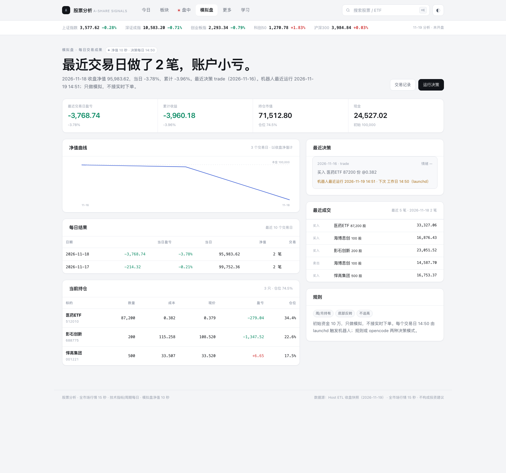
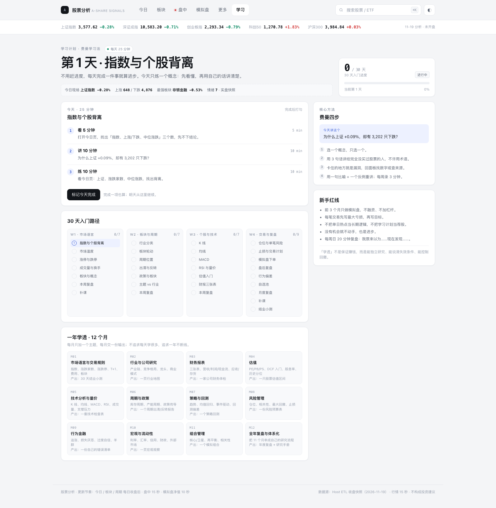

# 股票分析 · 产品交付文档

**版本** v3.10 · **日期** 2026-11-22 · **状态** 数据新鲜度 + 自动更新版  
**插件显示名** 股票分析  
**包名 / 面板 id** `@local/sector-board` / `sector-board`（均保持不变）  
**配套 UI 稿** [`docs/ui-v3.html`](ui-v3.html)（可交互；实际面板拉真实数据，接口不可用时显示错误与重试，不回退假数据）  
**上一版 UI** [`docs/ui-v2.html`](ui-v2.html)（保留作历史对照）  
**历史文档** [`docs/PRD-v3.0-archive.md`](PRD-v3.0-archive.md)、[`docs/PRD-v1.2-archive.md`](PRD-v1.2-archive.md)

---

## 0. 交付摘要

### 0.1 一句话

把原来的「九宫格看板」收成 **六个主入口**：**今日、板块、盘中、模拟盘、更多、学习**。  
首屏只回答一个问题：**今天发生了什么、钱在往哪里去、要不要动手。**

### 0.2 这次为什么改

v3.0 的「5 工作区 + 全局搜索 + 个股抽屉」信息很全，但用户反馈很直接：

> 「感觉不是很简洁。」

问题不在功能少，而在 **第一眼没有结论**。v3 系列的目标不是再加一个页面，而是做减法：

| 用户要的 | v3.10 的答案 |
|---|---|
| 第一眼知道最近热点、资金在关注什么 | 今日首屏：一句结论 + 6 个数字 + 3 条资金叙事 + 8 个概念热点 + 8+8 行业红黑榜 + 6 条盘中异动 |
| 板块在大涨/大跌、小周期/大周期、出清/反转 | 板块页：11 个周期主题按状态排序，点开看 ETF、龙头、出清链条 |
| 个股 MACD、金叉死叉、分时、5/10/月均线 | 全局搜索 → 右侧技术抽屉：分时 / 日 K / 周 K / 月 K + MA + MACD + RSI |
| 模拟盘每日交易成果 | 模拟盘页：今日盈亏、净值、每日结果、持仓、决策与成交 |
| 今日板块热点太少 | 今日：概念热点 8 个 + 行业红黑榜 8+8 |
| 周期板块要能查政策 | 板块详情：政策追踪（倾向 + 3 条政策 + 政策库外链） |
| 事件日历要有推荐做法 | 更多：6 个事件，T-1/当日/T+1/T+5 + 推荐做法 |
| 新手不知道怎么学 | 学习：30 天入门 + 12 个月进阶 + 费曼四步 + 每日 25 分钟 |

### 0.3 交付物

| 文件 | 说明 |
|---|---|
| `docs/PRD.md` | 本文档：范围、信息架构、页面规格、设计系统、验收 |
| `docs/ui-v3.html` | v3.8 高保真 UI 稿壳，74 行，引用同目录 assets |
| `docs/assets/ui-v3.css` | v3.10 视觉系统，1,168 行，明暗双主题、响应式 |
| `docs/assets/ui-v3.js` | v3.10 交互、真实数据 hydration、全市场实时聚合、周期机会排序、公告抽屉、学习计划与技术抽屉，2,510 行，零外部依赖 |
| `docs/assets/mock-data-v2.js` | 仅 v2 历史稿使用的归档数据，v3 不加载 |
| `docs/learning-plan.md` | 新手学习计划全文：30 天表、一年路线、费曼法、复盘模板 |
| `docs/assets/ui-preview-v3-*.png` | 今日/板块/盘中/模拟盘/更多/抽屉/暗色预览图 |
| `docs/ui-v2.html` | v2 驾驶舱，保留作历史版本，不再作为主推 |

打开方式：浏览器直接打开 `docs/ui-v3.html`（无 Host 接口时显示错误态）；实际面板通过 iframe 指向 Host 静态页 `/api/sector-board/v3/ui-v3.html`，打开后自动请求 Host 接口。必须与 `docs/assets/` 保持相对路径，移动时整个 `docs/` 一起移。

### 0.4 预览

**今日**：先给结论，再给证据。



**板块**：周期主题 + 出清链条 + 龙头。



**盘中**：交易时段 15 秒刷新，真实接口单态；预览为 2026-11-19 收盘后的真实快照。



**模拟盘**：每日结果与真实错误态。



**学习**：每天 25 分钟，完成一项算进步；30 天入门 + 12 个月进阶。



更多预览见 `docs/assets/ui-preview-v3-more.png`、`ui-preview-v3-live.png`、`ui-preview-v3-drawer.png`、`ui-preview-v3-dark.png`。

### 0.5 当前接入状态（v3.10）

**v3.10 是实际面板的唯一界面**：`client.js` 的 iframe 通过 `src` 指向 Host 静态页 `/api/sector-board/v3/ui-v3.html`，打开「股票分析」即整页显示，不再有「v3 设计预览 / 切换实时看板」二选一，旧九分区入口已删除。

- 启动先显示 boot 加载层，再 `hydrate()` 并行请求 `dashboard.json` / `paper.json` / `hot.json` / `events.json` / `global.json` / `etf.json`；成功后 ribbon 显示「分析日期 · 行情时刻」；失败显示错误与重试，不展示任何假数据。
- 今日/板块/模拟盘/更多均读真实数据：指数来自 `global.json`，情绪/涨跌结构/行业/概念/主题/龙虎榜/游资/红利来自 `dashboard.json`，模拟盘来自 `paper.json`，事件来自 `events.json`，全球来自 `global.json`。
- 个股抽屉按需请求 `/stock.json?period=day` 与 `?period=min`，展示真实日线/周线/月线与分时；接口失败显示错误，不生成 K 线。
- **全市场实时层（v3.8）**：`docs/assets/universe-data.js` 提供 5,584 只代码 + 32 个行业 + 138 个概念 + 11 个主题成员表；交易时段每 15 秒按 300 只一组并行请求 `/live.json?codes=`（5,584 只 + 927 ETF，共 22 批），在浏览器重算市场宽度、行业/概念/主题均涨、涨跌停与情绪，并回填所有展示价格；ribbon stamp 显示 `分析日期 · 行情 HH:MM:SS`，休市显示 `分析日期 · 已收盘`。
- **仍非实时**：技术信号（MA/MACD/RSI）、周期阶段、决策候选/风险、龙虎榜/红利/事件仍来自每日 ETL；界面标注「全市场 15 秒 · 分析每日」，不用实时价格伪装这些字段。
- 模拟盘与更多页每 10 秒拉 `paper.json` / `global.json`；`dashboard.json` 每 5 分钟检测 `generated_at`，有新 ETL 结果才重绘。
- 搜索先查本地索引，再用 `/search?q=` 远程补全；因此任意 6 位代码都能打开抽屉。
- 学习页的 30 天进度存 `localStorage`（键 `sb-learn-done-v1`），刷新/重开面板不丢；纯前端，不需要新接口。
- v3 页面由 Host 静态路由直接提供；改完 docs 后刷新 DSH 页面即可。Host 路由改动需重启 DSH。

### 0.6 本阶段不包含 / 边界

- 不修改 package name、panel id、Host 路由、数据目录。
- 不接券商，不做实盘下单。
- 不新增付费数据源，现有 ETL 口径不变。
- 不做移动端原生 App；响应式最低覆盖到 720px，主验收宽度 1500/1280。
- 政策追踪是 11 个周期主题的**公开资料整理**，不是实时政策库；每条标「政策摘要 · 公开资料整理」并给政策库外链。
- 盘中为免费行情源，约 3–15 秒延迟、无 L2；异动规则是阈值判定，不构成交易建议。
- 全市场实时聚合依赖免费行情源：每 15 秒 22 批请求、约 6,511 个标的，实测本机 22 批并行 <450ms；若行情源限流或 Host 不可用，页面显示错误/重试，不回退假数据。
- 技术信号、周期阶段、决策候选/风险、龙虎榜/红利/事件仍按每日 ETL；这是数据能力边界，不是刷新开关。
- 5,584 只中停牌/无报价的个股不参与实时宽度计算，因此市场总数可能与 ETL 的 5,579 略有差异。
- v3 首屏只保留高频入口；低频大表（人气榜前 30、监控池 500、概念 138、周期 12、红利 120）暂不放在首屏，去向见附录 A。

---

## 1. 背景与问题

### 1.1 现状

现有插件是单页面板，顶部标题、徽章、搜索、刷新，下面平铺 9 个 tab：

`决策 / 盘中 / 总览 / 信息 / 周期 / 热点 / 红利 / 全球 / 机器人`

数据侧已比较完整：全 A 股约 5,000 只、35 个申万行业组（含未分类）、138 个概念板块、11 个主题、120 只红利样本、龙虎榜约 95 行、模拟盘 10 万初始资金。技术抽屉支持分时、日/周/月线、MA5/10/20/60、成交量、MACD、RSI；不含 BOLL/KDJ/ATR（与当前实现一致）。

问题不在数据量，而在 **信息架构**。

### 1.2 核心问题

1. **九个平级 tab，没有任务分层。** 「决策」和「全球」一样重，新用户不知道从哪开始。
2. **第一屏没有结论。** 打开先看到指数、涨跌家数、一排 pill，需要自己拼出「今天该不该动手」。
3. **表格密度高、字号小。** 10.5–11.5px 的表格，层级靠字重硬撑，看久了累。
4. **功能入口深且分散。** 个股技术分析、板块成分、主题成分、龙虎榜席位分散在不同 tab，交互不一致。
5. **v2 的修正。** v2 把九分区收成 5 个工作区，但仍然是一屏多卡片；用户看到的是「很多正确的信息」，不是「一个明确的判断」。

### 1.3 v3.10 设计原则

- **结论先行**：标题就是判断，数字是证据，明细按需展开。
- **少即是多**：首屏 1 个结论、6 个数字、3 条叙事、6 条异动；不追求一屏放完所有功能。
- **红涨绿跌只用于价格**；品牌色用靛蓝，避免整页红绿噪音。
- **所有个股同一入口**：搜索或点击名称 → 右侧技术抽屉。
- **零外部 UI / 图表依赖**：继续手写 SVG，降低插件体积与升级风险。
- **明暗双主题**：默认浅色，右上角切换；颜色全部走 CSS 变量。

---

## 2. 信息架构

### 2.1 六个主入口

| Tab | 回答的问题 | 首屏内容 | 默认状态 |
|---|---|---|---|
| **今日** | 今天发生了什么，钱在往哪去 | 结论、情绪、6 个数字、3 条资金叙事、8 个概念热点、6 条异动、8+8 板块红黑榜、龙虎榜/游资、模拟盘小卡 | 默认打开 |
| **板块** | 哪些板块在涨/跌，处于周期什么位置 | 11 个周期主题按状态排序；右侧 ETF、龙头、出清/反转链条 | 周期主题 |
| **盘中** | 现在谁在动，异动是什么 | 交易状态、5 个 KPI、异动流、监控池；09:15–15:00 每 15 秒刷新 | 交易时段自动刷新 |
| **模拟盘** | 机器人每天做得怎么样 | 今日盈亏、净值曲线、每日结果、持仓、决策、成交 | 只读 |
| **更多** | 低频但需要时能找到的工具 | 红利、全球、事件日历 | 低频入口 |
| **学习** | 新手每天该学什么、怎么算学会 | 今日 25 分钟、30 天入门清单、12 个月路线、费曼四步 | 每日 25 分钟 |

### 2.2 用户路径

```text
打开面板
  └─ 今日：看标题与 6 个数字，判断今天是否值得动手
       ├─ 点「板块红黑榜」/「看板块周期」→ 板块
       ├─ 点异动里的股票名 → 技术抽屉
       ├─ 点「盘中」→ 实时异动流 + 监控池（交易时段每 15 秒）
       ├─ 搜索股票/ETF → 技术抽屉
       └─ 点模拟盘小卡 → 模拟盘看日结
```

### 2.3 首屏信息预算

| 区域 | 数量 | 目的 |
|---|---:|---|
| 结论标题 | 1 | 一句话判断 |
| 情绪/宽度数字 | 6 | 情绪、涨跌、涨停、跌停、中位、极端走势 |
| 资金叙事 | 3 | 主线、风险、情绪，各一条 |
| 盘中异动 | 6 | 最近发生了什么 |
| 板块红黑榜 | 8 + 8 | 行业强弱（领涨/领跌各 8，覆盖更多热点） |
| 概念热点 | 8 | 领涨概念 + 龙头，回答「钱在炒什么」 |
| 资金关注 | 3 + 2 | 龙虎榜 + 游资 |
| 模拟盘小卡 | 1 | 机器人今日结果 |

首屏只保留「概念热点」这一组次级热点，不再堆多组同权重卡片；这是 v2 被说「不简洁」后收敛的重点。

### 2.4 数据更新频率（界面必须显式标注）

| 页面 / 模块 | 更新频率 | 界面文案 |
|---|---|---|
| 今日 / 板块 / 周期 的价格、指数、市场宽度 | 交易日 15 秒；休市首屏拉一次 | `全市场 15 秒`（ribbon stamp） |
| 行业 / 概念 / 主题 平均涨跌 | 交易日 15 秒，浏览器聚合 | `全市场 15 秒 · 分析每日` |
| 技术信号 / 周期阶段 / 决策候选 | 每日 ETL，收盘后 | `分析每日`（详情页 `周期每日`） |
| 盘中异动 | 交易日 09:15–11:30 / 13:00–15:00，每 15 秒 | `实时 · 15 秒` |
| 模拟盘净值 | 10 秒 | `净值 10 秒` |
| 模拟盘决策 | 每日 14:50 | `决策每日 14:50` |
| 更多 · 红利 / 事件 | 每日 | `红利 / 事件每日` |
| 更多 · 全球 | 10 秒 | `全球 10 秒` |

落地方式：每个页面 kicker 右侧放 `.cadence` 胶囊；ribbon 的 stamp 交易中显示 `分析日期 · 行情时刻`，休市显示 `分析日期 · 已收盘`；页脚再给一行总说明。盘中页的状态条还要显示「最近更新」和「实时接口 / 接口不可用」。

### 2.4.1 数据新鲜度与自动更新（v3.10）

**问题**：ETL 是每日收盘后任务，但过去没有自动调度；如果某天没跑，面板会一直停在旧日期（例如周六仍显示周四）。这不是接口实时性问题，而是分析层快照过期。

**规则**：
- 页面用 `expectedTradingDate()` 估算最近交易日：16:00 前算上一工作日，周末回退到周五；`as_of < expected` 时今日页显示「数据滞后」条，写明「截至 X，最近交易日 Y」。
- 滞后条提供「更新数据」按钮：`POST /api/sector-board/refresh` 启动 Host ETL，每 5 秒轮询 `status.json`，完成后自动 `hydrate(true)`；更新约 4–6 分钟。
- 自动更新：macOS launchd `com.sly.sector-etl`，工作日 16:10 执行 `python3 etl.py --if-fresh`，日志 `/tmp/etl-launchd.log`；DSH 定时任务 16:40 作为兜底（App 未开时由 launchd 负责）。
- `--if-fresh` 已是最新则跳过，避免重复跑；周末/节假日不会把旧快照标成实时。
- 全市场行情仍按交易时段 15 秒刷新；分析层（技术信号/周期/决策候选/龙虎榜/红利/事件）明确标「分析每日」，不因价格实时而假装更新。

**验收**：把系统日期调到周六、`dashboard.json` 仍为周四时，今日页出现「数据滞后 · 截至周四，最近交易日周五」；点击更新后 ETL 跑完，日期变为周五且滞后条消失；工作日 16:10 后 dashboard 的 `as_of` 为当天（节假日除外）。

### 2.5 全市场实时层（v3.8）

| 数据 | 来源 | 刷新 | 回填位置 |
|---|---|---|---|
| 指数 | `/live.json`（腾讯实时） | 交易时段 15 秒 | ribbon、今日 lede、学习页现场 |
| 全市场 5,584 只 + 927 ETF 价格/涨跌/成交额/换手/量比 | `/live.json` × 22 批 | 交易时段 15 秒 | 今日/板块/盘中/模拟盘/更多/抽屉/搜索命中 |
| 市场宽度（涨跌家数/涨跌停/中位/均涨） | 浏览器按全市场报价重算 | 15 秒 | 今日 pulse、ribbon、盘中 KPI |
| 行业/概念/主题平均涨跌 | `universe-data.js` 成员表 + 实时报价 | 15 秒 | 板块页、今日红黑榜、概念热点、周期表 |
| 情绪分 | 浏览器按 ETL 同公式重算 | 15 秒 | 今日情绪仪表 |
| 模拟盘净值/持仓 | `/paper.json` | 10 秒 | 模拟盘、今日小卡 |
| 全球指数/商品/外汇 | `/global.json` | 10 秒 | 更多、ribbon 的 A 股指数 |
| 技术信号/周期阶段/决策候选/龙虎榜/红利/事件 | `dashboard.json` | 每日 ETL；页面每 5 分钟检测新快照 | 今日/板块/更多 |

原则：**价格、宽度、板块均涨实时；技术指标与周期判断每日**。不把 ETL 快照读成实时，也不因实时价格改动技术信号。

---

## 3. 页面规格

### 3.1 今日

#### 3.1.1 顶部

- kicker：`2026-11-19 周四 · 全市场行情 · 未开盘` + `全市场 15 秒 · 分析每日` 徽章；接口失败时显示错误态，不回退
- H1：`指数微红，个股很冷。`
- lede：`上证 +0.09%，但 3,202 只下跌、中位 -0.86%。资金没有扩散，只在通信/CPO 和半导体设备里抱团。先看今天发生了什么，再看哪些板块在出清。`
- 右侧动作：`刷新数据`（真实请求）、`看板块周期`（跳板块）

#### 3.1.2 六个数字

| 数字 | 标签 | 数据 |
|---|---|---|
| 41 | 情绪 · 中性 | 情绪分 0–100 |
| 1,318 | 上涨 / 3,202 下跌 | 涨跌家数 |
| 42 | 涨停 / 0 跌停 | 涨停、跌停家数 |
| -0.86% | 个股中位涨跌 | 中位数，不用均值 |
| 1,366 | 近 20 日大跌 | 技术信号计数 |
| 1 / 0 | 天地板 / 地天板 | 极端走势，复盘样本 |

规则：数字用等宽字体、`tabular-nums`；上涨红、下跌绿；中性数字用正文色。四个字以内标签，避免换行。

#### 3.1.3 今天资金在炒什么

三条纵向叙事，每条：序号、标题、说明、右侧数值/标签、2–3 个证据 chip。

1. **通信 / CPO：唯一有持续性的方向**  
   通信行业均涨 +2.10%，CPO/光模块 +1.85%。华胜天成 4 天 3 板、生益电子 +18.53% 登上龙虎榜，净买 3.68 亿。资金没有扩散，只在算力链里抱团。  
   chips：`华胜天成 4天3板` `生益电子 +18.53%` `龙虎榜净买 3.68 亿`
2. **3,202 只下跌，高位股开始补跌**  
   下跌占比 64%，1,366 只近 20 日大跌。九阳股份 -9.99% 走出天地板，冰山冷热换手 47% 但只涨 4.73%。指数微红，赚钱效应很差。  
   chips：`下跌 3,202` `近期大跌 1,366` `天地板 1`
3. **41 分，中性偏冷；不追高**  
   情绪温度 41，结论是「中性，按计划执行」。涨停家数还有 42 家，但跌停 0 家、中位 -0.86%，说明是少数票的结构性行情。  
   chips：`情绪 41` `涨停 42` `跌停 0`

交互：chip 可点股票/标签，打开技术抽屉或搜索。

#### 3.1.4 盘中异动

6 条，按时间倒序；每条：时间、名称、事件说明、标签、涨跌幅。

| 时间 | 标的 | 事件 | 标签 | 涨跌 |
|---|---|---|---|---|
| 14:52 | 华胜天成 | 4 天 3 板 | 异动 | +10.01% |
| 14:41 | 生益电子 | 龙虎榜净买 3.68 亿 | 异动 | +18.53% |
| 14:26 | 九阳股份 | 天地板 | 杀跌 | -9.99% |
| 14:03 | 深南电路 | 涨停打开后回封 | 异动 | +10.00% |
| 13:37 | 冰山冷热 | 换手 47.3% | 异动 | +4.73% |
| 13:07 | 兴齐眼药 | 底部反转候选 | 候选 | +2.20% |

规则：名称可点，统一开抽屉；标签颜色：异动=红、杀跌=绿、候选=靛蓝；今日只放 6 条复盘样本，实时异动流在「盘中」页（3.7）。

#### 3.1.5 右侧栏

- **概念热点**：按平均涨跌取前 8 个概念（成分数 ≥ 3），显示概念名、今日平均涨跌、成分数、龙头；点击跳龙头个股抽屉。
- **板块红黑榜**：领涨 8 个行业、领跌 8 个行业；行内显示名称、微条形、平均涨跌；标题显示「上涨行业数 / 有效行业数」。过滤 `avg_pct == null` 和「未分类」。
- **资金在关注**：龙虎榜净买前 3；游资净买前 2，过滤净买额 ≥ 12 亿的异常值（奥精医疗 26.78 亿属于数据异常，不展示）。
- **模拟盘小卡**：日期、当日涨跌、持仓数/交易数/决策；点击进入模拟盘。

#### 3.1.6 数据与刷新

- 首屏分析数据来自 ETL 快照；全市场行情在交易时段每 15 秒刷新，打开时先拉一次。
- 「刷新数据」在原型里是 toast；正式接入时调用现有 `POST /refresh`。
- 优先显示真实数据；接口失败显示错误与重试，不展示假数据。
- 顶部必须有 `全市场 15 秒 · 分析每日` 徽章；全市场行情与板块均涨实时，技术信号/周期阶段每日。

### 3.2 板块

#### 3.2.1 模式

- 默认：**周期主题 11**。
- 可切：**行业涨跌 34**（35 个行业组去掉「未分类」）。
- 切换按钮在标题右侧，`seg` 控件，按钮不换行。
- 页面 kicker 标 `全市场 15 秒 · 分析每日`；周期/行业详情 kicker 末尾标 `均涨实时 · 周期每日`。

#### 3.2.2 周期主题表

列：主题、今日、5 日、小周期位置、大周期位置、状态、龙头。

- 排序：**机会分从高到低**，同分再按状态优先级。机会分 = 状态基准分 + 5 年分位修正 + 1 年分位修正；机会标签为「机会 / 关注 / 中性 / 回避 / 无成分」。
- 每行在主题名后加机会标签，并在副标题下用一行说明「为什么有机会」：5 年分位、1 年分位、近 5 日、今日、首个先行指标；完整理由放在右侧详情。
- 小周期 = 1 年分位中位数；大周期 = 5 年分位中位数；用细进度条 + 百分比，避免只看颜色。
- 龙头 = 主题成分股市值第一的当日涨跌。
- 首屏只展示 11 行，不做分页；恒生科技无 A 股成分时整行显示「— / 无成分」。
- 默认选中机会分最高的主题，不再固定选中第 4 行。

**当前 11 个主题与状态**

| 主题 | 分组 | 状态 | 今日 | 5 日 | 小周期 | 大周期 | 龙头 |
|---|---|---|---:|---:|---:|---:|---|
| 猪肉 | 消费周期 | 底部出清 | -0.99% | -2.0% | 8% | 10% | 牧原股份 -0.55% |
| 房地产 | 地产链 | 反转观察 | +0.19% | -6.4% | 2% | 10% | 招商蛇口 -1.32% |
| 机器人 | 科技周期 | 底部 | -0.31% | -9.8% | 3% | 28% | 工业富联 +5.68% |
| 影视 | 消费周期 | 底部 | -0.75% | -8.3% | 10% | 19% | 光线传媒 -2.19% |
| 光伏 | 新能源周期 | 底部 | -0.21% | -7.1% | 3% | 21% | 比亚迪 -0.25% |
| 电池 | 新能源周期 | 底部 | -0.55% | -8.8% | 2% | 26% | 宁德时代 +1.05% |
| CPO/光模块 | 科技周期 | 超跌反弹 | +1.85% | -14.8% | 9% | 74% | 工业富联 +5.68% |
| 半导体 | 科技周期 | 底部震荡 | +0.30% | -9.4% | 5% | 45% | 长鑫科技 +1.99% |
| 有色金属 | 资源周期 | 底部震荡 | -1.24% | -9.4% | 1% | 43% | 宏桥控股 -1.12% |
| 稀土永磁 | 资源周期 | 底部震荡 | -0.76% | -9.1% | 1% | 42% | 中国铝业 -2.26% |
| 恒生科技 | 科技周期 | 无成分 | — | — | — | — | — |

#### 3.2.3 主题详情

点行 → 右侧详情（窄屏变下方卡片）：

1. 一句话结论：`猪肉：价格越跌，出清越近，但还没到反转确认。`
2. **机会卡**：机会标签 + 机会分 + 为什么有机会（状态、5 年分位、1 年分位、近 5 日、今日、先行指标）+ 出清/反转确认条件。
3. 四个读数：今日、5 日、1 年位置、5 年位置。
4. 估值：PE 中位、PB 中位、成分数。
5. 出清 / 反转链条：3–4 步，例：
   `能繁母猪存栏领先约 10 个月 → 亏损去化 → 供给收缩 → 猪价反转`
6. 先行指标 chips：`能繁母猪存栏` `猪粮比` `自繁自养利润` `行业资产负债率`
7. 政策追踪：每个周期主题给 3 条政策样本（日期、发文机关、标题、一句影响），标注政策倾向（强支持/支持/规范产能/托底/规范收紧等）；底部给「去政策库查」外链。政策摘要标注公开资料整理，不伪装实时政策库。
8. 相关 ETF：养殖 ETF、畜牧 ETF、农业 ETF（代码 + 名称；价格暂不展开）
9. 龙头股 5–6 只：名称、代码、现价、今日涨跌；点击开抽屉，PE/PB/市值在抽屉内展开。
10. 动作：`看龙头技术面`、`全部成分`（原型 toast；正式版接现有成分面板）。

**文案要求**：解释「为什么」而不是只给指标。猪周期必须出现「母猪存栏领先约 10 个月」这条产业逻辑；光伏要看硅料价格；影视要看票房/排片；有色要看铜价/库存。

#### 3.2.4 行业模式

- 34 个申万一级行业，按今日平均涨跌排序。
- 列：行业、今日、上涨/下跌、涨停、成分数。
- 详情：当日强弱 + 说明「行业级出清指标尚未接入；周期位置请切到周期主题」。
- 不伪造行业级 PE/PB 分位；没有数据就写「未接入」。

#### 3.2.5 数据边界

- 主题状态、位置、PE/PB 来自 `dashboard.themes`。
- 龙头股来自 `theme.stocks` 前 6（按市值）。
- 行业均值来自 `dashboard.sectors`，`avg_pct` 为 null 的行业不参与红黑榜。
- ETF 在原型中是示例；正式版从 `etf.json` 按主题关键词匹配。

### 3.3 模拟盘

#### 3.3.1 标题与 KPI

- kicker：`模拟盘 · 每日交易成果` + `净值 10 秒 · 决策每日 14:50` 徽章
- H1：`今天买了两笔，账户小亏。`
- lede：日期、收盘净值、当日、累计；机器人 23:35 hold；11-18 14:50 运行失败原样保留。
- KPI 4 个：今日盈亏、累计收益、持仓市值、现金。

#### 3.3.2 净值与每日结果

- 净值曲线：29 个交易日，纵轴自适应，本金 100,000 虚线。
- 每日结果：最近 10 个交易日，列日期、当日盈亏、当日、净值、交易笔数。
- 当前持仓：标的、数量、成本、现价、盈亏、仓位；仓位分母用 `nav`，与资产配置一致。
- 最近决策：日期/动作/情绪、摘要、运行时间与错误。
- 最近成交：最近 5 笔，标题写清「最近 5 笔 · 11-17 2 笔」，不把 11-16 的成交说成当日。
- 规则卡：周/月持有、底部反转、不追高；初始 10 万、只做模拟、不接实时下单；工作日 14:50 launchd 触发。

#### 3.3.3 真实错误态

- 顶部 lede 和最近决策卡都保留：`11-18 14:50 运行失败：robot.py:187 NoneType`。
- 不把失败写成「运行正常」；这是产品诚实度的一部分。
- 正式接入时把完整 traceback 放到折叠区，首屏只留一行。

### 3.4 更多

三个低频工具，保持一屏可扫；页面 kicker 标 `红利 / 事件每日 · 全球 10 秒`：

1. **红利策略**：股息率 ≥ 3%、按股息率降序，展示前 8；列标的、股息率、PE、1 年位置；点开抽屉。
2. **全球市场**：A 股指数 7、港股 4、美股 6、商品 4、外汇 4；只读，10 秒刷新在正式版保留。
3. **事件日历**：未来 6 个事件，按日期排序；每个事件给 T-1/当日/T+1/T+5 胜率、均值、样本 n，并给出「推荐做法」（会前/会后/仓位）与策略标签。历史基准率来自上证 1600 根日线实算，推荐做法是规则化示例，不构成投资建议。

首屏不放入人气榜前 30、概念 138、周期 12、红利全表；这些是「研究/复盘」低频动作，见附录 A。监控池与实时异动放到「盘中」页，首屏只留 6 条复盘样本。

### 3.5 个股技术抽屉

#### 3.5.1 打开方式

- 搜索股票/ETF → 点结果。
- 点击任意 `[data-stock]`：异动名、持仓、龙头、红利行、龙虎榜行。
- URL 不带路由；抽屉是页面内浮层，关闭后回到原 tab。

#### 3.5.2 内容

- 头部：名称、代码、现价、涨跌、行业。
- 周期 tab：分时 / 日 K / 周 K / 月 K；ETF 只有分时。
- 图例：日/周/月显示 MA5/10/20/60；分时显示「价格 / 均价」。真实接口有分时点时标注「ETL 快照 · 非逐笔」；无接口时显示「暂无分时」。
- 主图：蜡烛 + 均线 + 成交量 + MACD；分时：价格线 + 均价线 + 昨收虚线。
- 指标卡 6 个：MACD、均线、RSI14、零轴、1 年位置（生成数据写「区间位置」）、量比（生成数据写「量能」）。
- 技术解读：一句话，包含均线排列、MACD 交叉、零轴位置、RSI、支撑/压力。
- 关键位：20 日支撑、20 日压力、MA20 距离。
- 候选证据 / 触发 / 失效：仅对真实候选股（如 300573 兴齐眼药）显示。
- 公司公告：个股抽屉底部展示最近 5–8 条公告（日期、类型、标题，点击打开原文）；数据来自 `/api/sector-board/announcements.json?code=`，未命中时 Host 会按需调用 `announcements.py --codes <code> --merge` 抓取并缓存。
- 底部：加入自选、查看完整行情（原型 toast）。

#### 3.5.3 真实数据与空态

- 个股抽屉按需请求 `/stock.json?period=day` 与 `?period=min`：真实日线标「真实日线 · ETL 快照」，真实分时标「分时 · 真实行情」；请求失败显示错误，不生成 K 线。
- 其他股票：必须请求真实 `/stock.json`；接口失败显示错误，不生成序列。
- 分时：接口可用时用 `/stock.json?period=min` 的 `points` 绘制；不可用时显示「暂无分时」。不声称逐笔。
- ETF：只有分时 + 说明「技术指标以跟踪指数为准」。

### 3.6 搜索

- 输入框占位：`搜索股票 / ETF`；⌘K / Ctrl+K 聚焦。
- 索引：`M.stock`、主题成分、行业 peers、概念 peers、hot、lhb、youzi、decision leaders/risks、paper positions、ETF。
- 类型与分组顺序：股票 → ETF → 主题 → 行业；概念不单独成组，作为股票标签/行业归属出现。
- 键盘：↑↓ 选择、Enter 打开、Esc 关闭。
- 结果行：名称 + 代码、类型/行业、现价 + 涨跌；空态给示例「兴齐眼药 / 510300」。
- 点结果：股票/ETF 开抽屉；主题跳板块并选中；行业跳行业模式。

### 3.7 盘中（第 5 个 Tab）

#### 3.7.1 目标

回答「现在谁在动、发生了什么异动、下一步看哪只」。全市场行情层在交易时段走真实 `/live.json`，非交易时段保留最近快照；其他 tab 共享同一轮报价。

#### 3.7.2 顶部与状态条

- 导航第 3 个位置：「盘中」，带红点；kicker：`盘中异动` + `实时 · 15 秒` 徽章。
- H1：交易中 `现在，钱在往哪跑。`；休市 `休市了，看最近一次异动。`
- lede：`交易日 09:15–11:30、13:00–15:00 每 15 秒刷新监控池。异动规则：跌停撬板、涨停打开、5 分钟内急拉 / 急跌 ≥ 1.5%。`
- 状态条：交易状态（集合竞价 / 上午交易 / 午间休市 / 下午交易 / 已收盘 / 周末休市 / 未开盘）、`最近更新 HH:MM:SS`、轮询说明、监控池数量、数据来源（`实时接口` / `接口不可用`）。

#### 3.7.3 五个 KPI

监控池只数、上涨/下跌、异动条数、最大涨幅（附股票名）、最快涨速（附股票名）。无涨速数据时显示 `—` 和「本轮暂无涨速」，不补假数字。

#### 3.7.4 异动流

- 数据来自 `/live.json` 的 `events`：`type/text/code/name/price/pct/at`。
- 规则：跌停撬板、涨停打开、20 秒–5 分钟内涨跌 ≥1.5% 的急拉/急跌；同 code:type 2 分钟去重；Host 最多保留 80 条、返回前 40。
- 页面取前 18 条；行内：时间、名称、事件文案、涨跌幅；点击开技术抽屉。
- 空态：`本轮还没有触发异动。` + 规则说明；下方监控池按当前排序展示最活跃的票。
- 实时接口不可用时显示「实时接口不可用」与空列表；不伪造 `最近更新` 时间。

#### 3.7.5 监控池

- 代码池：主题成分（每主题前 20）、决策 leaders/risks、人气榜、模拟盘持仓，去重后 ≤500 个 6 位代码。
- 排序：涨速 / 量比 / 涨跌幅；默认涨速。
- 列：标的、现价、涨跌幅；实时模式追加涨速、量比、成交额。接口不可用时隐藏这三列，避免整列「—」。
- 最多显示 60 行，表体滚动；行点击开抽屉。

#### 3.7.6 刷新与降级

- 交易时段每 15 秒把全市场按 300 只一组拆成 22 批请求 `/api/sector-board/live.json?codes=...`；09:15–09:25 集合竞价、09:25–11:30 上午、13:00–15:00 下午均轮询；11:30–13:00 和 15:00 后不轮询，只显示最近快照。
- 打开页面时立即请求一次；手动刷新按钮随时可用。
- `file://` 静态预览、接口 4xx/5xx、网络失败：显示错误与重试，不回退、不伪造数据。
- DSH 面板的 iframe `srcdoc` 已通过真实 Host 接口验证：相对 `/api/...` 命中父页面 origin，`实时接口`、六列表格、异动流均正常；接口失败显示错误态。

#### 3.7.7 验收

- 交易时段每 15 秒刷新；`最近更新` 时间变化。
- 非交易时段显示休市/已收盘和快照，不自动轮询。
- 无接口时明确显示错误与重试，且不出现空白页或 console error。

### 3.8 学习（第 6 个 Tab）

#### 3.8.1 目标

给完全新手一条**每天 25 分钟、能坚持一年**的路径；不追求一次学完，而是每天一个概念、一次费曼讲解、一次在面板里找证据。对应产品目标：让用户从「看热闹」变成「能独立研究、能说清风险」。

#### 3.8.2 首屏结构

- 顶部：`第 N 天 · 概念名`；`学习计划 · 费曼学习法` + `每天 25 分钟` 徽章。
- 右上：30 天进度卡（已完成 / 30、进度条、当前第 N 天）。
- 今日 25 分钟：看 5 分钟、讲 10 分钟、练 10 分钟；三步都写清「今天具体做什么」。
- 今日现场条：真实指数、上涨/下跌、最强板块、情绪分、`实盘快照/错误态` 来源；让学习和当天市场对齐，不是空教材。
- 费曼四步：选一个概念 → 用 3 句话讲给完全没买过股票的人 → 卡住回炉 → 比喻 + 反例重讲；今天讲的问题放在最显眼位置。
- 30 天入门：4 周 × 7–8 天清单，完成打勾，当前天高亮，可点任意天回看。
- 12 个月：每月一个主题 + 一个输出，强调「每月交一份输出」，不是「每天加量」。
- 新手红线：前 3 个月只模拟盘、不杠杆、每笔先写最大亏损、不把热点当长期逻辑、不把计划当荐股。

#### 3.8.3 交互与持久化

- 点「标记今天完成」：写入 `localStorage` 键 `sb-learn-done-v1`，自动跳到下一个未完成天。
- 点 30 天清单任意一行：切换到该天，不回退已完成状态。
- 「重看今天」：回到当前天；「重置」：二次确认后清空进度。
- 没有开始日期/连续天数惩罚；断一天就从当前天继续，符合「时间不严谨」的要求。
- 学习页不新增 Host 接口；完成状态纯前端，刷新/重开面板不丢。

#### 3.8.4 验收

- 首次打开显示第 1 天，进度 0/30；有 30 个日条目、12 个月条目、3 个今日任务、4 步费曼法。
- 标记完成后进度 +1、自动跳下一天；刷新页面进度保留。
- 1500/1280/860/720 无横向滚动；暗色可读。
- 无 console error；不出现空白页。

---

## 4. 设计系统

### 4.1 视觉方向

**信号优先的编辑部版面**：大标题、少卡片、细边框、充分留白；不是 Bloomberg 满屏终端，也不是卡片堆叠 dashboard。

- 页面最大宽度 1180px，左右 24px（720px 以下 14px）。
- 顶栏 60px，指数 ribbon 42px，卡片圆角 12px，边框 1px。
- 卡片之间 16px；页面区块之间 28–32px。
- 标题 38–42px，行高 1.2；正文 13–14px；辅助 11–12px；表格 12.5px。
- 数字一律等宽 + `tabular-nums`，右对齐。

### 4.2 颜色

| Token | 浅色 | 深色 | 用途 |
|---|---|---|---|
| `--bg` | `#f4f5f7` | `#0a0c10` | 页面底色 |
| `--surface` | `#ffffff` | `#11141a` | 卡片 |
| `--surface-2` | `#f8f9fb` | `#171b22` | 次级块 |
| `--line` | `#e4e7ec` | `#252b36` | 边框 |
| `--text` | `#12151a` | `#edf0f5` | 主文字 |
| `--text-2` | `#5c6472` | `#a5adba` | 次文字 |
| `--text-3` | `#939baa` | `#6f7887` | 辅助 |
| `--accent` | `#3156d3` | `#7f96ff` | 品牌/链接/候选 |
| `--up` | `#d33b3b` | `#ff7070` | 上涨 |
| `--down` | `#0a8a63` | `#3bd6a4` | 下跌 |
| `--warn` | `#a4660a` | `#e3a548` | 风险 |
| `--violet` | `#6e54c9` | `#b19cff` | 周期/标签 |

规则：**红涨绿跌只用于价格/涨跌**；品牌、选中、链接统一靛蓝；风险用琥珀，不用红色抢价格语义。深色模式保持同一语义，不反色。

### 4.3 字体

```css
--sans: -apple-system, BlinkMacSystemFont, "SF Pro Text", "PingFang SC", "Microsoft YaHei", sans-serif;
--mono: "SF Mono", ui-monospace, "JetBrains Mono", Menlo, monospace;
```

中文标题 600–650 字重；正文 400；数字 500。禁止用 300 字重（小字会发虚）。

### 4.4 组件

| 组件 | 规格 |
|---|---|
| 顶栏 | 60px；品牌 + 5 tab + 搜索 + 主题按钮；sticky |
| 指数 ribbon | 42px；最多 5 个指数（1280 以下 4、720 以下 3）+ 日期；不横向滚动 |
| 大标题 | 38–42px；只允许一句话，不加副标题堆叠 |
| KPI 条 | 4–6 格；1px 分隔；数字上、标签下 |
| 叙事行 | 序号 + 标题/说明 + 右侧数值；hover 背景 `--surface-2` |
| 异动行 | 时间 40px + 名称/事件 + 标签 + 涨跌；名称可点 |
| 表格 | 12.5px；行高 44–48px；表头 10.5px 大写/字距；数字右对齐 |
| 状态标签 | 底部出清（琥珀）、反转观察（靛蓝）、底部（绿）、超跌反弹（红）、无成分（灰） |
| 按钮 | 28–32px 高；主按钮黑底白字，次按钮白底边框 |
| 抽屉 | 780px；右侧滑入；遮罩 `rgba(0,0,0,.4)`；宽度 < 960 时全屏 |
| 搜索下拉 | 420px；分组标题；行高 40px；键盘选中态 |
| 空态 | 一句话 + 一个入口；不放大插画 |

### 4.5 图表

- 全部手写 SVG，无 ECharts / D3 / Chart.js。
- K 线：64 根视图，日/周（5 日聚合）/月（21 日聚合）；红涨绿跌；MA5/10/20/60；成交量；MACD 柱 + DIF/DEA。
- 分时：241 个点，价格 + 均价 + 昨收虚线；不画假成交量。
- 净值：29 个点，本金虚线，纵轴自适应。
- 条形：板块红黑榜、周期位置；宽度用百分比，不用 canvas。

### 4.6 响应式

| 断点 | 行为 |
|---|---|
| > 1120 | 今日双栏（主 1.55fr / 侧 0.9fr）；ribbon 5 个指数 + 日期 |
| 960–1120 | 今日双栏收窄；搜索 176px；ribbon 4 个指数；侧栏仍右置 |
| 720–960 | 今日单栏；板块详情变下方卡片；抽屉全屏；ribbon 4 个指数，隐藏日期 |
| < 720 | 搜索收成图标；导航文字保留；ribbon 3 个指数；表格隐藏次要列 |

主验收宽度：1500、1280、860；不要求手机端完美。

### 4.7 无障碍

- 所有按钮有文本或 `aria-label`；搜索框有 `aria-label`。
- 颜色不是唯一信息：涨跌同时有符号/文字，状态有文字标签。
- 键盘：Tab 可达按钮/输入；⌘K 聚焦搜索；↑↓/Enter/Esc 操作结果；抽屉 Esc 关闭。
- 对比度：正文 `#12151a` on `#fff`、`#5c6472` on `#fff` 达到 AA；辅助 `#939baa` 只用于非关键信息。
- 未做正式 WCAG 审计；接入前补焦点陷阱（当前抽屉未锁焦点）。

---

## 5. 交互状态

| 状态 | 表现 |
|---|---|
| 加载中 | 正式版：骨架屏；原型无 loading |
| 数据为空 | 一句话 + 一个动作；例：恒生科技「暂无 A 股成分」 |
| 行情缺失 | 现价 `—`，涨跌 `—`，不显示 0.00% |
| 搜索无结果 | 「没有找到。试试：兴齐眼药 / 510300 / 半导体」 |
| 抽屉打开 | 遮罩 + 右侧滑入；焦点到关闭按钮；Esc 关闭 |
| 抽屉关闭 | 清除 `state.stock`；回到原 tab |
| 主题切换 | 立即生效；写入 `document.documentElement.dataset.theme`；原型不持久化 |
| 刷新 | 真实请求：重新拉取 ETL 快照，失败显示错误 |
| 机器人失败 | 顶部 lede + 决策卡保留错误，不用 toast 掩盖 |
| 异常数据 | 净买 > 12 亿的游资异常值过滤；`avg_pct=null` 行业不进红黑榜 |

---

## 6. 数据与接口

### 6.1 数据来源

| 数据 | 来源 | 频率 |
|---|---|---|
| 全 A 股清单/日线 | 新浪清单 + 雪球/新浪/腾讯日线 | ETL 每日 |
| 申万一级行业 | emweb | ETL 每日 |
| 概念板块 | 本地 board_cache | ETL 每日 |
| 估值/分红/龙虎榜 | 东方财富 | ETL 每日 |
| 指数/全球/外汇 | 腾讯行情 | 面板打开时 / 全球 10 秒 |
| 盘中异动 | 腾讯批量报价 + `detectLiveEvents` | 交易日 09:15–11:30、13:00–15:00 每 15 秒 |
| 人气榜 | 同花顺 | 3 分钟（v3 暂不首屏） |
| 事件基准率 | 上证 1600 根日线实算 | 6 小时缓存 |
| 模拟盘 | `paper.json` + `paper.py` | 每日 14:50 |
| 公司公告 | 东方财富公告接口（主）/ 巨潮资讯（兜底） | 按需；默认关注池预取 |

### 6.2 Host 接口

`/api/sector-board/dashboard.json`、`etf.json`、`search.json`、`global.json`、`quotes.json?codes=`、`paper.json`、`status.json`、`live.json?codes=`、`events.json`、`hot.json`、`stock.json?code=&period=`、`announcements.json?code=`；POST `/refresh`、`/paper/decide`、`/paper/init`、`/robot/run`、`/announcements/refresh`。

公告接口：读取 `~/.dsh/sector-board/announcements.json`；请求的 code 不在缓存时，Host 按需执行 `announcements.py --codes <code> --merge` 再返回。`announcements.py` 可用 `--codes`、`--days`、`--limit-per-code`、`--max-codes`、`--workers`、`--merge`、`--source eastmoney|cninfo` 独立运行。

v3.10 不再渲染内置 `window.MOCK`；打开先显示 boot 加载层，由 `hydrate()` 请求真实接口并写入 `M`：`dashboard.json` 提供 market/signals/decision/sectors/concepts/themes/lhb/youzi/dividend；`paper.json`/`hot.json`/`events.json`/`global.json`/`etf.json` 并行补全。任一接口失败显示错误与重试，不回退假数据。`sectors[]`/`concepts[]` 的 `lists` 按信号分组、没有 `peers`，前端用 `peersFromLists()` 去重取涨幅前 8 补成「今日信号股」。个股 `stock.json` 的 `bars` 是对象数组，前端转 `[d,o,h,l,c,v]`；盘中 `live.json` 必须带 `codes`，返回 `{updated_at,count,rows,events}`，字段保持现有契约。

### 6.3 数据来源与降级说明

- 快照 `as_of=2026-11-19`，`generated_at=2026-11-19T21:59:52+08:00`，`total=5579`，`sectors_count=31`。
- 指数、全球、龙虎榜、红利、主题、情绪为真实快照值。
- 所有个股 K 线与分时必须来自 `/stock.json`；无数据时显示空态，不生成。
- 板块/概念展示股来自 `lists` 信号分组，按涨幅取前 8；没有 `peers` 时显示信号标签，不伪造价格。
- 模拟盘 `paper.json` 为 11-18 收盘状态；11-18 14:50 机器人失败为真实日志。
- 今日/板块/模拟盘/更多在接口可用时显示「实盘快照」，失败时显示错误与重试；盘中页在接口可用时显示「实时接口」，失败时显示「实时接口不可用」。

### 6.4 关键数值（2026-11-19 实盘快照）

- 指数：上证 3,577.62 -0.28%；深成 10,583.20 -0.71%；创业板 2,293.34 -0.79%；科创50 1,270.78 +1.83%；沪深300 3,984.84 +0.03%；中证500 6,251.96 -0.48%；中证1000 5,938.90 -1.88%。
- 市场（全市场实时聚合，11-19 收盘后）：上涨 638 / 下跌 4,532；涨停 28 / 跌停 83；中位 -2.44%；情绪 8「冰点」；有效报价 5,170 只。
- 模拟盘：以 `paper.json` 最近交易日为准；页面按真实持仓与报价重算市值。
- 龙虎榜与红利明细以 2026-11-19 ETL 结果为准，面板内逐行展示，不在文档里复制大表。


---

## 7. 性能预算

| 项 | 预算 |
|---|---:|
| `ui-v3.html + css + js`（不含成员表） | ≤ 160KB |
| `universe-data.js`（5,584 只 + 行业/概念/主题成员） | ≤ 400KB |
| `mock-data-v2.js` | 仅 v2 历史稿使用，v3 不加载 |
| 首屏 DOM 节点 | ≤ 1,500 |
| 首屏渲染 | ≤ 100ms（本地） |
| K 线重绘 | ≤ 16ms（160 根日线聚合） |
| 外部请求 | 交易时段每 15 秒 22 批 `/live.json`（全市场 + ETF）；模拟盘/全球各 10 秒；dashboard 5 分钟检测 |
| 第三方 UI/图表库 | 0 |

当前 `ui-v3.html` 74 行、CSS 1,139 行、JS 2,417 行、`universe-data.js` 377,559 字节；无构建步骤、无 CDN。

---

## 8. 实施计划

### Phase 1 · 壳、今日与盘中静态（0.5 天）

- 顶栏、ribbon、6 tab 路由、深色切换；盘中直接接真实接口。
- 今日：结论、6 数字、3 叙事、8 概念热点、6 异动、8+8 红黑榜、资金关注、模拟盘小卡。
- 验收：1500/1280 无横向滚动；首屏 5 秒能说清「今天怎么样」。

### Phase 2 · 板块与详情（1 天）

- 周期主题/行业切换、11 行主题表、详情（ETF/龙头/链条/指标）。
- 空态（恒生科技）、`avg_pct=null` 过滤。
- 验收：猪周期详情能讲清「母猪存栏 → 出清 → 反转」；点龙头开抽屉。

### Phase 3 · 模拟盘与更多（0.5 天）

- 模拟盘 KPI/净值/每日结果/持仓/决策/成交。
- 更多：红利、全球、事件。
- 验收：失败态保留；成交标题与列表一致。

### Phase 4 · 抽屉、搜索与盘中实时（1 天）

- 分时/日K/周K/月K、MA、成交量、MACD、指标卡。
- 搜索索引、分组、⌘K、↑↓/Enter。
- 盘中：`/live.json` 15 秒轮询、交易时段判断、接口失败错误态。
- 验收：搜索「兴齐眼药」「510300」都能打开；分时图例正确；盘中在交易时段刷新、休市不轮询。

### Phase 5 · 接入 Host（1.5 天）

- 用现有 `dashboard.json / paper.json / search.json / quotes.json` 替换 `window.MOCK`；盘中保留 `/live.json` 实时入口。
- 保留现有路由与数据目录；只改 `client.js` 的展示层。
- 旧九分区入口与切换已删除；v3 是唯一界面。

**总计约 4.5 人天**，不含 ETL 改动。v2 文件保留，不做删除。

---

## 9. 验收标准

1. 打开面板默认今日；1500/1280 宽度无横向滚动。
2. 首屏 5 秒内能读出：指数微红、个股很冷、情绪 41、主线通信/CPO。
3. 6 个数字与数据源一致；涨红跌绿；数字等宽。
4. 今日 6 条异动可点，点名称打开技术抽屉。
5. 板块默认 11 个周期主题；状态排序符合「底部出清 → 反转观察 → 底部 → …」。
6. 点猪肉能看到 ETF、6 只龙头、四步出清链条、四个先行指标和 3 条政策追踪。
7. 点龙头/红利行/持仓/龙虎榜行/概念热点都能开抽屉；Esc 关闭。
8. 事件日历每个事件都显示 T-1/当日/T+1/T+5 与推荐做法。
9. 抽屉日K显示 MA5/10/20/60、成交量、MACD；分时显示价格/均价且图例正确。
10. 搜索「兴齐眼药」「510300」「半导体」分别命中股票/ETF/主题；↑↓/Enter 可用。
11. 模拟盘显示今日盈亏、累计、净值、每日结果、持仓、决策；11-18 失败态保留。
12. 深色主题下 ribbon、卡片、表格、抽屉均正常，无白底闪块。
13. 接口可用时所有页面标「实盘快照」，失败时显示错误与重试、不展示假数据；无 console error；`docs/assets/ui-preview-v3-*.png` 与当前版本一致。
14. 今日红黑榜各 8 条、概念热点 8 条；周期详情有政策追踪；事件日历有推荐做法。
15. 6 个 tab 顺序为 今日 / 板块 / 盘中 / 模拟盘 / 更多 / 学习；今日与板块/周期显示「全市场 15 秒 · 分析每日」，模拟盘显示「净值 10 秒 · 决策每日 14:50」，更多显示「红利/事件每日 · 全球 10 秒」。
16. 盘中在交易时段每 15 秒请求 `/live.json`；显示交易状态、最近更新、实时接口/错误态；非交易时段显示快照；失败时显示错误与重试且不报错。
17. 学习页显示第 N 天、30 个日条目、12 个月条目、3 个今日任务、4 步费曼法；完成一天后进度 +1 并跳下一天，刷新后 localStorage 保留。
18. 交易时段停在今日/板块/模拟盘/更多，全市场价格/宽度/板块均涨/情绪每 15 秒变化；技术信号与周期阶段不随价格跳动；页脚写明「全市场行情 15 秒 · 分析每日」。
19. 数据新鲜度：`as_of` 落后最近交易日时今日页显示「数据滞后」条与「更新数据」按钮；更新完成后日期前进、滞后条消失；launchd `com.sly.sector-etl` 工作日 16:10 已加载，DSH 16:40 兜底任务存在。

---

## 10. 风险与待办

| 风险 | 影响 | 处理 |
|---|---|---|
| v3 首屏删掉人气榜/概念 138，监控池移到盘中 | 老用户找不到 | 附录 A 明确去向；Phase 5 保留旧版开关 |
| 周期「出清」文案是研究判断，不是事实 | 误导 | 每条链条标注「分析框架，非投资建议」；数值仍来自快照 |
| 非 300573 的 K 线曾为生成数据 | 用户以为真实 | 已删除生成逻辑，统一请求 `stock.json` |
| 分时接口无数据 | 用户以为实时 | 显示「暂无分时」，不生成序列 |
| 游资净买异常值 | 榜单失真 | 过滤 ≥ 12 亿；数据侧修 `youzi` 聚合 |
| `robot.py:187` NoneType | 模拟盘决策失败 | 已记录；修复后再宣称「自动运行正常」 |
| 抽屉未做焦点陷阱 | 键盘可逃逸 | 接入前补 `inert` / focus trap |
| 720px 以下表格信息丢失 | 移动端可用性 | 首版只保证 860px；移动端后续单独设计 |
| 盘中接口限流 / 字段空值 | 异动流断更或表格整列「—」 | 15 秒轮询、失败显示错误；接口不可用时隐藏涨速/量比/成交额列 |
| 学习计划被当成收益承诺 | 新手误以为学完就能赚钱 | 首屏与计划全文都写明「不保证收益」，前 3 个月只模拟盘 |

---

## 附录 A · 旧功能去向

| 旧功能 | v3 位置 | 状态 |
|---|---|---|
| 决策 · 情绪温度计 | 今日 6 数字 + 叙事 03 | 首屏 |
| 决策 · 今日结论/触发条件 | 今日标题 + lede | 首屏 |
| 决策 · 底部反转候选 15 | 今日异动「候选」+ 抽屉候选证据 | 部分；完整表后续 |
| 决策 · 高位风险 15 | 今日叙事 02 | 部分；完整表后续 |
| 盘中 · 异动直播 | 盘中 · 异动流（前 18 条）+ 今日 6 条复盘样本 | 已实现 |
| 盘中 · 监控池 ≤500 | 盘中 · 监控池（≤60 行） | 已实现 |
| 热点 · 人气榜前 30 | — | 后续「更多 → 人气榜」 |
| 热点 · 龙虎榜 | 今日资金关注 3 条 | 首屏精简 |
| 热点 · 游资 | 今日资金关注 2 条 | 首屏精简 |
| 总览 · 指数条 | ribbon 5 个 | 首屏 |
| 总览 · 市场温度/涨跌家数 | 今日 6 数字 | 首屏 |
| 总览 · 7 类技术信号 | 今日「近 20 日大跌」+ 异动标签 | 部分 |
| 总览 · 申万 31/概念 138 | 板块行业 34 | 行业保留；概念后续 |
| 总览 · Treemap/卡片/表格 | 板块表格 | 表格保留；热力后续 |
| 总览 · 板块成分/技术标签 | 板块龙头 6 + 抽屉 | 首屏精简 |
| 总览 · 全局搜索 | ⌘K 搜索 | 首屏 |
| 信息 · 事件日历/基准率 | 更多 · 事件日历 | 低频 |
| 周期 · 11 主题 | 板块默认 | 首屏 |
| 周期 · 12 周期行业 | — | 后续「更多 → 周期行业」 |
| 红利 | 更多 · 红利前 8 | 低频精简 |
| 全球 | 更多 · 全球 5 组 | 低频 |
| 机器人/模拟盘 | 模拟盘 + 今日小卡 | 首屏 |
| 个股技术抽屉 | 全局抽屉 | 首屏 |
| 股票详情 | 抽屉头部 + 指标 | 合并 |
| 刷新数据 | 今日按钮 | 保留 |
| 九分区旧版 | `docs/ui-v2.html` + 旧 PRD | 归档 |

**结论**：v3 不是删功能，而是把「每天都看」的放首屏，把「复盘才看」的放更多/后续；低频大表在迁移期保留旧版开关。

---

## 附录 B · 数据文件与运行状态

- `docs/ui-v3.html`：74 行，壳。
- `docs/assets/ui-v3.css`：1,168 行，设计系统。
- `docs/assets/ui-v3.js`：2,510 行，渲染、全市场实时聚合、机会排序、公告抽屉与交互。
- `docs/assets/universe-data.js`：377,559 字节，5,584 只代码 + 32 行业 + 138 概念 + 11 主题成员表。
- `docs/assets/mock-data-v2.js`：仅 v2 历史稿使用，v3 不加载。
- `client.js`：151,613 字节，只渲染 iframe 指向 Host 静态页（不再内嵌 v3 HTML）。
- `announcements.py`：公司公告抓取脚本，输出 `~/.dsh/sector-board/announcements.json`。
- `docs/assets/ui-preview-v3-{today,sectors,live,paper,more,learn,drawer,dark,panel}.png`。
- 真实快照：`~/.dsh/sector-board/dashboard.json`、`paper.json`、`etf.json`、`search.json`、`board_cache.json`、`industry_cache.json`。
- 全市场报价缓存：`/tmp/quotes.json`（4,712 只）。
- 调试脚本：`/tmp/cdp-v3-check.mjs`、`/tmp/cdp-v3-shots.mjs`、`/tmp/cdp-v3-smoke.mjs`、`/tmp/cdp-v3-responsive.mjs`、`/tmp/cdp-v3-drawer.mjs`。

## 附录 C · 变更记录

| 版本 | 日期 | 变更 |
|---|---|---|
| v3.0 | 2026-11-18 | 5 工作区驾驶舱；用户反馈「不简洁」 |
| v3.1 | 2026-11-18 | 收敛为 4 tab；今日结论先行；板块周期主题 + 出清链条；模拟盘日结；技术抽屉分时/均线/MACD；新增 v3 UI 稿 |
| v3.2 | 2026-11-19 | 今日 8 概念热点 + 8+8 行业红黑榜；周期主题详情政策追踪；事件日历 6 个事件 + 推荐做法；预览图同步 |
| v3.3 | 2026-11-19 | 新增盘中异动第 5 个 tab（交易日 09:15–11:30 / 13:00–15:00 每 15 秒）；今日/板块/周期/模拟盘/更多标注更新频率；盘中接口失败显示错误态 |
| v3.4 | 2026-11-19 | 接入真实 Host 数据：dashboard/paper/events/global/hot/etf + 个股 stock.json + 远程 search；今日/板块文案动态化，行业「信号股」、真实分时/日线；删除旧九分区入口与预览切换，v3 成为唯一面板 |
| v3.5 | 2026-11-19 | 新增「学习」第 6 个 tab：30 天入门清单 + 12 个月进阶路线 + 费曼四步 + 每日 25 分钟任务 + localStorage 进度；配套 `docs/learning-plan.md` |
| v3.7 | 2026-11-19 | 实时行情层：全 tab 指数/个股/ETF/榜单/持仓价格 15 秒回填，模拟盘/全球 10 秒，dashboard 5 分钟检测；ribbon 交易中显示「分析日期 · 行情时刻」、休市显示「已收盘」；明确「价格实时、分析每日」边界 |
| v3.8 | 2026-11-20 | 全市场实时聚合：5,584 只代码 + 927 ETF 按 300 只 × 22 批拉取，浏览器重算市场宽度/行业/概念/主题均涨/情绪；`universe-data.js` 成员表；技术指标与周期阶段仍每日 ETL；彻底移除演示数据 |
| v3.9 | 2026-11-20 | 周期主题按机会分排序并显示「为什么有机会」；主题详情机会卡；个股抽屉接入公司公告；新增 `announcements.py`（东方财富主源、巨潮兜底）与 `/api/sector-board/announcements.json` 按需抓取 |
| v3.10 | 2026-11-22 | 修复 ETL 过期导致面板停在旧日期：新增「数据滞后」提示与手动更新；launchd 工作日 16:10 自动跑 ETL，DSH 16:40 兜底；ETL 已补跑至 2026-11-20 |
| v1.2 | 2026-11-17 | 九分区 + 实时 + 模拟盘（归档） |
